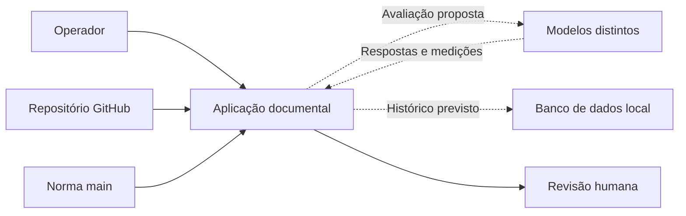
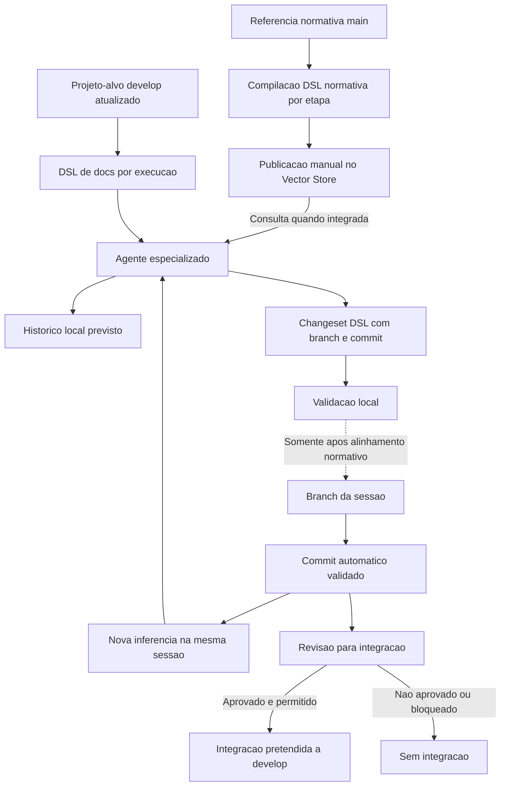

# Doc Arquitetura — Revisão documental e comparação de modelos

  

## Resumo executivo
A aplicação Doc Arquitetura permitirá organizar a revisão e o refinamento documental de projetos GitHub, utilizando diferentes provedores remotos de LLM, por quatro especializações: Charter, Scope, Implementation e Source. Compilará localmente a referência normativa externa `ahhvahh/doc-arquitetura/main/ProjectCharter/1.0`, manterá as configurações de cada agente reutilizável até uma atualização explícita, analisará o `/docs` atualizado do projeto-alvo e produzirá alterações rastreáveis para revisão antes da publicação em branch de tarefa, condicionada à autorização normativa.

## Propósito do projeto
| Campo | Definição |
|---|---|
| Problema | Analisar projetos extensos exige contexto elevado, gera custos diferentes por modelo e ainda não oferece histórico comparável de qualidade, tokens e despesas. |
| Propósito | Permitir refinamento documental por diferentes provedores remotos de LLM, com sessões contínuas de inferência, histórico local em métricas JSON recuperáveis, comparação de qualidade e custos e aprovação humana para integrar alterações à `develop`. |
| Beneficiários | Desenvolvedor responsável, revisor documental e operador da aplicação Debian. |
| Valor esperado | Menor trabalho manual de contexto, consistência normativa, alterações verificáveis e escolha de modelos apoiada por indicadores históricos de qualidade, consumo, tempo e custo. |

## Contexto e participantes
- [PCH-001 — Projeto e participantes](project-context/PCH-001-contexto-integracao-openai-dsl.md).

## Contexto multimodelo proposto
O diagrama representa as relações pretendidas, não funcionalidades já implementadas.

## Visão geral de alto nível

A DSL normativa é atualizada no Vector Store somente por comando explícito do operador, nunca por preparação de tarefa ou inferência. A cópia é derivada do SHA da main normativa e não substitui o Markdown original; consulta pelo agente depende de integração de pesquisa ainda pendente. Cada execução usa workspace isolado e projeto-alvo independente. O diagrama descreve intenção de produto, **não concede permissão** de escrever em branches de sessão nem de executar merge: a [OPEN-003](open-questions/OPEN-003-politica-de-branches.md) continua bloqueadora até a atualização autorizada da política normativa. A autorização de gastos de inferência é independente da revisão para integração Git.

## Objetivos e entregas esperadas
- [OBJ-001 — Quatro especializações](objectives/OBJ-001-agentes-documentais-especializados.md)
- [OBJ-002 — Contexto compacto e rastreável](objectives/OBJ-002-contexto-compacto-rastreavel.md)
- [OBJ-003 — Propostas verificáveis para revisão](objectives/OBJ-003-propostas-de-alteracoes-verificaveis.md)
- [OBJ-004 — Evidência de testes automatizados](objectives/OBJ-004-evidencias-de-testes-automatizados.md)
- [OBJ-005 — Inferência com orçamento controlado](objectives/OBJ-005-orcamento-previsivel-e-bloqueio.md)
- [OBJ-006 — Publicação manual da base normativa](objectives/OBJ-006-publicacao-manual-base-normativa.md)
- [OBJ-007 — Comparação entre modelos](objectives/OBJ-007-comparacao-controlada-de-modelos.md)
- [OBJ-008 — Histórico de inferências](objectives/OBJ-008-historico-local-de-inferencias.md)

## Fora do escopo
- [NOBJ-001 — Sem integração autônoma à develop](non-objectives/NOBJ-001-nao-publicar-sem-aprovacao.md)
- [NOBJ-002 — Sem inferência local na primeira entrega](non-objectives/NOBJ-002-sem-inferencia-local-na-primeira-entrega.md)

## Condições e premissas
- [CON-001 — Referência normativa versionada](conditions/CON-001-referencia-normativa-main.md)
- [CON-002 — Proteção de credenciais](conditions/CON-002-protecao-credenciais.md)
- [CON-003 — Separação entre norma externa e contratos do aplicativo](conditions/CON-003-contratos-do-aplicativo.md)
- [CON-004 — Orçamentos e aprovação prévia](conditions/CON-004-orcamento-obrigatorio.md)
- [CON-005 — Persistência local](conditions/CON-005-persistencia-local-de-inferencias.md)

## Questões abertas
- [OPEN-001 — Credenciais e armazenamento](open-questions/OPEN-001-politica-credenciais.md)
- [OPEN-002 — Fidelidade e orçamento de contexto](open-questions/OPEN-002-fidelidade-e-custo.md)
- [OPEN-003 — Política de branches](open-questions/OPEN-003-politica-de-branches.md)
- [OPEN-004 — Limites remotos por projeto OpenAI](open-questions/OPEN-004-projeto-openai-e-hard-limit.md)
- [OPEN-005 — Provedores e modelos](open-questions/OPEN-005-estrategia-de-provedores-e-modelos.md)
- [OPEN-006 — Retenção e sigilo do histórico (decisão C resolvida)](open-questions/OPEN-006-retencao-e-protecao-do-historico.md)

## Base normativa pesquisável — decisão de Charter

O operador poderá solicitar a compilação e sincronização manual da norma, separadamente para Charter, Scope, Implementation e Development (src). O comando apresenta prévia sem publicação por padrão; aplicação explícita habilita o envio em formato textual pesquisável. A aplicação compara hashes, registra versões e confirma indexação, evitando uploads redundantes. A publicação não executa agentes nem altera repositórios. Regras de consulta e contratos da CLI serão definidos em Scope e Implementation após os gates. Veja [OBJ-006](objectives/OBJ-006-publicacao-manual-base-normativa.md) e [OPEN-002](open-questions/OPEN-002-fidelidade-e-custo.md).

## Situação da baseline
**BLOCKED — Charter → Scope.** Esta é uma proposta inicial em `refinement`. A implementação não está autorizada por este rascunho. Requer revisão do responsável, validação das OPEN e auditoria completa dos critérios normativos.

## Histórico e referência
- [Referência normativa](https://github.com/ahhvahh/doc-arquitetura/tree/main/ProjectCharter/1.0) — somente leitura; `main`.
- [Projeto-alvo](https://github.com/ahhvahh/doc-arquitetura-app-debian/tree/develop) — branch de desenvolvimento.

## Registro da ampliação — 2026-10-21
A inclusão de comparação multimodelo e histórico local foi autorizada para refinamento documental; não equivale à conclusão de implementação ou do gate. As questões [OPEN-001](open-questions/OPEN-001-politica-credenciais.md), [OPEN-002](open-questions/OPEN-002-fidelidade-e-custo.md), [OPEN-003](open-questions/OPEN-003-politica-de-branches.md), [OPEN-004](open-questions/OPEN-004-projeto-openai-e-hard-limit.md), [OPEN-005](open-questions/OPEN-005-estrategia-de-provedores-e-modelos.md)  permanecem abertas para análise individual. A [OPEN-006](open-questions/OPEN-006-retencao-e-protecao-do-historico.md) teve sua decisão de retenção, acesso e descarte resolvida; controles técnicos exigem verificação posterior.

## Decisões funcionais de 2026-10-21 — provedores, sessões e métricas
- A [OPEN-005](open-questions/OPEN-005-estrategia-de-provedores-e-modelos.md) registra a opção B, múltiplos provedores remotos, mantendo a escolha inicial dos serviços pendente de viabilidade.
- A [OPEN-003](open-questions/OPEN-003-politica-de-branches.md) registra o fluxo desejado de **uma branch por sessão**, commits automáticos de resultados validados, novos prompts na sessão ativa e aprovação humana **somente da integração Git a `develop`**. A execução permanece bloqueada pela norma atual.
- O [OBJ-008](objectives/OBJ-008-historico-local-de-inferencias.md) exige métricas JSON recuperáveis para consulta e reconstrução de análises por aplicações autorizadas, sem impor formato interno do banco nesta etapa.

## Decisão sobre retenção do histórico — 2026-10-21
A opção C foi aprovada: **prompts, respostas e métricas JSON permanecem armazenados até exclusão manual**, sem expiração automática. Somente o operador e consumidores expressamente autorizados podem consultar os dados. Segredos devem ser protegidos e descartes devem ter evidência auditável sem exposição do conteúdo excluído.

A decisão está em [OPEN-006](open-questions/OPEN-006-retencao-e-protecao-do-historico.md), com requisitos em [OBJ-008](objectives/OBJ-008-historico-local-de-inferencias.md) e [CON-005](conditions/CON-005-persistencia-local-de-inferencias.md). O documento mantém badge `refinement` por indisponibilidade do badge `refined` em `docs/assets/`; este registro não autoriza alterar assets nem atesta controles implementados.

## Seleção de provedores da primeira entrega — 2026-10-21
**Registro histórico substituído pela decisão 22:** o responsável havia escolhido **OpenAI, Anthropic e Google Gemini** como provedores remotos **previstos**. A decisão nominal está em [OPEN-005](open-questions/OPEN-005-estrategia-de-provedores-e-modelos.md) e se reflete em [OBJ-001](objectives/OBJ-001-agentes-documentais-especializados.md), [OBJ-007](objectives/OBJ-007-comparacao-controlada-de-modelos.md) e [PCH-001](project-context/PCH-001-contexto-integracao-openai-dsl.md).

A escolha não significa implementação nem disponibilidade comprovada: cada serviço deve ser avaliado quanto a APIs, modelos/versões, custos, métricas, credenciais, tratamento de dados e limites financeiros. Sem evidências e controles suficientes, bloquear inferência paga e manter a pendência no Charter; nenhuma integração técnica ou código foi alterado nesta decisão.

## Política de autorização de inferências pagas — decisão de 2026-10-21
O responsável escolheu a opção A da [OPEN-004](open-questions/OPEN-004-projeto-openai-e-hard-limit.md): **bloquear qualquer chamada paga sem proteção remota suficiente, efetiva e comprovada**, além de limites locais e autorização financeira por inferência. Essa condição aplica-se às **duas integrações atualmente previstas, OpenAI e agentes Amazon Bedrock (AWS)**, e a quaisquer integrações remuneradas futuras; não pode ser substituída por alertas, teto apenas local ou aceitação de risco.

Permanecem previstos **quatro projetos OpenAI independentes**, um por especialização, cuja proteção financeira precisa ser verificada individualmente antes de uso remunerado. A decisão não comprova disponibilidade de hard limits nem habilita modelos remotamente. Requisitos vinculados: [OBJ-005](objectives/OBJ-005-orcamento-previsivel-e-bloqueio.md), [CON-004](conditions/CON-004-orcamento-obrigatorio.md) e [OPEN-005](open-questions/OPEN-005-estrategia-de-provedores-e-modelos.md).

## Decisão de controle da qualidade documental — 2026-10-21
O responsável escolheu a **opção B** para a [OPEN-002](open-questions/OPEN-002-fidelidade-e-custo.md): cada resultado deverá passar por validação estrutural automatizada, **segunda análise por modelo de linguagem distinto** e **revisão humana final**. Um parecer favorável não dispensa testes nem comprova fidelidade semântica da DSL.

A segunda chamada é condicionada às restrições financeiras da [OPEN-004](open-questions/OPEN-004-projeto-openai-e-hard-limit.md), e o modelo revisor não possui autoridade de integração Git. A decisão está relacionada a [OBJ-003](objectives/OBJ-003-propostas-de-alteracoes-verificaveis.md), [OBJ-004](objectives/OBJ-004-evidencias-de-testes-automatizados.md), [OBJ-007](objectives/OBJ-007-comparacao-controlada-de-modelos.md) e [OBJ-005](objectives/OBJ-005-orcamento-previsivel-e-bloqueio.md).

A OPEN permanece em `refinement` até demonstrar a eficácia de validações, fidelidade da DSL, critérios de aceite e custos. Nenhuma integração, modelo secundário ou contrato técnico é declarado implementado.

## Política de execução segregada por usuário — decisão de 2026-10-21

**Registro histórico parcialmente superado (2026-10-22):** a exigência de execução sob identidade e credenciais pessoais foi substituída pela política de cofre administrativo e serviço autônomo descrita ao final deste Charter. Preservam-se controles de sigilo, autorização financeira, privacidade e auditoria.
O responsável escolheu a **opção C** na [OPEN-001](open-questions/OPEN-001-politica-credenciais.md): o serviço Linux poderá **organizar tarefas**, mas cada inferência será executada exclusivamente com a identidade e as credenciais do usuário autorizado correspondente, sem acesso cruzado aos cofres.

Persistem a segregação e a proteção de segredos em [CON-002](conditions/CON-002-protecao-credenciais.md), a autorização de gasto e a proteção remota de [OBJ-005](objectives/OBJ-005-orcamento-previsivel-e-bloqueio.md) e [CON-004](conditions/CON-004-orcamento-obrigatorio.md), bem como a divisão de participantes em [PCH-001](project-context/PCH-001-contexto-integracao-openai-dsl.md). A regra de quatro projetos OpenAI por especialização não foi substituída.

A decisão é uma orientação de produto, **não comprovação** de daemon, isolamento, cofre acessível em execução não interativa ou autorização efetiva. Tarefas sem identidade, cofre, isolamento ou proteção de gasto comprovados devem ser bloqueadas; os contratos técnicos ficam para Scope/Implementation.

## Resolução de divergências entre modelos — decisão de 2026-10-21
O responsável escolheu a **opção A** no refinamento da [OPEN-002](open-questions/OPEN-002-fidelidade-e-custo.md): divergências relevantes detectadas pelo segundo LLM devem ser **corrigidas e submetidas novamente a testes estruturais e análise crítica por outro modelo** antes da revisão humana final.

Falhas estruturais e normativas continuam bloqueadoras; sem reavaliação e resolução da discordância relevante, o conteúdo **não pode ser aceito nem registrado como resultado validado**. Repetições remuneradas exigem orçamento, autorização e proteção remota comprovada, segundo [OBJ-005](objectives/OBJ-005-orcamento-previsivel-e-bloqueio.md). Regras de aceite, testes e comparação estão relacionadas a [OBJ-003](objectives/OBJ-003-propostas-de-alteracoes-verificaveis.md), [OBJ-004](objectives/OBJ-004-evidencias-de-testes-automatizados.md) e [OBJ-007](objectives/OBJ-007-comparacao-controlada-de-modelos.md).

A autorização humana para integrar alterações à `develop` permanece separada, e a política de branches depende da [OPEN-003](open-questions/OPEN-003-politica-de-branches.md). A decisão é documental; **não demonstra implementação nem homologação da fidelidade semântica**.

## Limite de correções da inferência — decisão de 2026-10-21
O responsável substituiu a ausência de limite fixo da decisão 13 por **até quatro ciclos de correção e reavaliação após a tentativa inicial**. Cada ciclo reenviará todo o material de origem com a proposta e a observação mais recentes, repetindo testes estruturais e revisão de outro LLM, conforme [OPEN-002](open-questions/OPEN-002-fidelidade-e-custo.md).

O processo termina antecipadamente com proposta válida encaminhada à revisão humana, ou é **bloqueado** quando a quarta correção continuar inválida — sem uma quinta correção automática. Falhas normativas/estruturais e falta de proteção financeira ou de contexto integral também impedem continuar. Nenhum limite numérico autoriza despesa, integração Git ou aceite por exceção.

Relações: [OBJ-003](objectives/OBJ-003-propostas-de-alteracoes-verificaveis.md), [OBJ-004](objectives/OBJ-004-evidencias-de-testes-automatizados.md), [OBJ-005](objectives/OBJ-005-orcamento-previsivel-e-bloqueio.md) e [OBJ-007](objectives/OBJ-007-comparacao-controlada-de-modelos.md). Não há implementação ou homologação atestada.

## Governança de sessão documental e Pull Request — decisão de 2026-10-21
O aplicativo permitirá que o operador **escolha livremente o repositório GitHub de trabalho e o nível documental** a revisar, mantendo esse alvo distinto tanto do repositório do código do aplicativo como da referência normativa fixa. A sessão terá identificação própria e, após compatibilização normativa, usará uma branch **`feature/doc/{session-id}` derivada de `develop` do repositório escolhido**.

Todas as inferências de uma sessão ativa alimentarão a mesma branch, com commits produzidos pela aplicação **apenas para alterações validadas**. Para encerrar, o usuário deverá revisar e **aprovar expressamente o conjunto acumulado de alterações**; a aplicação então deverá **criar uma Pull Request da branch da sessão para `develop`**.

A PR passará por **GitHub Actions com verificações relevantes da documentação e da organização do repositório**, incluindo aderência normativa, escopo, links, IDs, status, integridade e testes pertinentes. Falhas obrigatórias bloqueiam integração; o processo deverá demonstrar que a proteção de `develop` exige esses checks. **Encerramento da sessão, abertura da PR e aprovação de merge são atos distintos**, e a integração final segue dependente de autorização humana e das regras de proteção da branch.

**Bloqueio normativo ainda vigente:** os agentes documentais estão atualmente autorizados a **escrever somente em `develop`**, segundo [OPEN-003](open-questions/OPEN-003-politica-de-branches.md) e a referência `ProjectCharter/1.0` na `main` de `ahhvahh/doc-arquitetura`. Esta decisão documenta o objetivo funcional, **não autoriza executar branches de sessão, PRs ou workflows**, nem altera normas, configuração, permissões ou código.

Relações: [OBJ-003](objectives/OBJ-003-propostas-de-alteracoes-verificaveis.md), [OBJ-004](objectives/OBJ-004-evidencias-de-testes-automatizados.md), [NOBJ-001](non-objectives/NOBJ-001-nao-publicar-sem-aprovacao.md) e [PCH-001](project-context/PCH-001-contexto-integracao-openai-dsl.md).

## Redefinição de tarefa por contexto insuficiente — decisão de 2026-10-21
O responsável aprovou, na [OPEN-002](open-questions/OPEN-002-fidelidade-e-custo.md), a **opção C**: se o material original integral acrescido da última proposta e observação ultrapassar a capacidade comprovada do modelo, **interromper a tentativa e pedir redefinição explícita do escopo e de uma nova baseline pelo operador**. É proibido truncar ou compactar silenciosamente o material para continuar.

Sem nova decisão humana, o resultado segue **bloqueado e não validado**. Uma nova tarefa terá identidade e baseline próprias, relacionadas ao histórico da tentativa interrompida, e deve passar novamente por testes estruturais, avaliação de segundo LLM e revisão humana. O limite de **quatro correções após a análise inicial** permanece vigente para cada tarefa, sem reinício automático para contorná-lo.

A redefinição não autoriza gastos, alteração de credenciais, criação de branch de sessão ou merge. Permanecem os controles de [OBJ-003](objectives/OBJ-003-propostas-de-alteracoes-verificaveis.md), [OBJ-004](objectives/OBJ-004-evidencias-de-testes-automatizados.md), [OBJ-007](objectives/OBJ-007-comparacao-controlada-de-modelos.md), [OBJ-005](objectives/OBJ-005-orcamento-previsivel-e-bloqueio.md) e o impedimento da [OPEN-003](open-questions/OPEN-003-politica-de-branches.md). Não se presume implementação nem homologação.

## Configuração variável por inferência e conversão DSL completa — decisão de 2026-10-21
O operador poderá manter **uma sessão aberta** para o repositório e nível documental escolhidos, com identidade, histórico e branch futura `feature/doc/{session-id}`, enquanto seleciona **a cada inferência o modelo/provedor autorizado, o tamanho de contexto dentro da capacidade efetiva e o prompt**. Cada chamada preservará identificação de sua configuração, versões, baseline, consumo e custo, sem converter uma escolha em configuração imutável da sessão.

A resposta pretendida do LLM será **DSL textual contendo título e descrição sugeridos para o commit, lista de todos os arquivos afetados e alterações documentais**. A aplicação será responsável por **validar e converter integralmente a DSL em Markdown**, preservando **tabelas, blocos de código, links, badges, gráficos representáveis, diagramas Mermaid e recursos vinculados**. Conteúdo inválido, ausente, não convertido ou não fiel impede commit de resultado validado; a DSL de origem e as razões ficam auditáveis.

As inferências seguem sujeitas à avaliação crítica de LLM distinto, ao máximo de **quatro correções por tarefa** e às autorizações financeiras e de segurança aplicáveis. O encerramento aprovado da sessão antecede PR e a autorização humana final de integração Git é independente. **A criação de branches e PRs por agentes permanece bloqueada pela norma externa vigente**, conforme [OPEN-003](open-questions/OPEN-003-politica-de-branches.md).

Relações: [OBJ-001](objectives/OBJ-001-agentes-documentais-especializados.md), [OBJ-002](objectives/OBJ-002-contexto-compacto-rastreavel.md), [OBJ-003](objectives/OBJ-003-propostas-de-alteracoes-verificaveis.md), [OBJ-004](objectives/OBJ-004-evidencias-de-testes-automatizados.md) e [OPEN-002](open-questions/OPEN-002-fidelidade-e-custo.md). Este registro não comprova implementação, gramática da DSL homologada ou testes executados.

## Recuperação de sessão após reprovação da PR — decisão de 2026-10-21
Foi aprovada a **opção A**: se uma PR da sessão reprovar nos checks obrigatórios, o trabalho volta ao estado **em correção**, preservando a sessão, a branch futura `feature/doc/{session-id}`, o histórico e a mesma PR. O operador poderá solicitar novas inferências e commits validados, com nova execução dos checks sobre o conteúdo atualizado. Uma nova aprovação humana de encerramento é obrigatória; o merge requer autorização humana **separada** e checks aprovados.

Esta é uma regra de produto **documentada, não implementada**. A criação de branches e PRs por agentes continua proibida na norma atual. Permanecem os controles de segurança, custo, segunda revisão e quatro correções por tarefa. Relações: [OPEN-003](open-questions/OPEN-003-politica-de-branches.md), [OBJ-003](objectives/OBJ-003-propostas-de-alteracoes-verificaveis.md) e [OBJ-004](objectives/OBJ-004-evidencias-de-testes-automatizados.md).

## Branch de sessão isolada e concorrência excluída — decisão de 2026-10-21
O responsável definiu que a futura branch `feature/doc/{session-id}` será criada **uma única vez a partir da `develop` na abertura** da sessão e não receberá automaticamente alterações posteriores da `develop`. Durante a sessão, eventuais atualizações observadas na **mesma branch remota da sessão** poderão ser refletidas na cópia local quando seguras; não se pretende gerenciar usuários que façam commits externos concorrentes nessa branch, conforme [NOBJ-003](non-objectives/NOBJ-003-nao-gerenciar-concorrencia-na-branch-da-sessao.md).

A divergência que comprometa atualização segura exige **bloquear a operação sem sobrescrever trabalho**. Não há promessa de merge/rebase automático, nem necessidade de avaliação por LLM de conflitos externos. [OPEN-003](open-questions/OPEN-003-politica-de-branches.md) preserva o impedimento normativo: agentes não podem criar ou atualizar branches de sessão nem PRs até que a referência externa seja formalmente compatibilizada. Trata-se de intenção funcional, não de implementação.

## Correção de divergências materiais e registro de sugestões editoriais — decisão de 2026-10-21
O responsável aprovou para a [OPEN-002](open-questions/OPEN-002-fidelidade-e-custo.md) a **opção B**: a segunda avaliação por LLM distinto do gerador exigirá **correção e reavaliação somente de divergências materiais**, como perda ou alteração de requisitos, mudança de significado, contradição, falha de integridade ou violação normativa. Sugestões comprovadamente **apenas editoriais** serão registradas e encaminhadas à revisão humana, sem obrigar outra correção automática.

A classificação exige evidência e não dispensa as validações estruturais. Dúvida não esclarecida sobre possível falha material não autoriza aceite silencioso. Permanecem **até quatro correções por tarefa**, contexto integral, verificação de qualidade, segurança e custos por inferência e segunda análise, com aprovação humana final de integração Git independente. Relações: [OBJ-003](objectives/OBJ-003-propostas-de-alteracoes-verificaveis.md), [OBJ-004](objectives/OBJ-004-evidencias-de-testes-automatizados.md) e [OBJ-007](objectives/OBJ-007-comparacao-controlada-de-modelos.md). Não pressupõe implementação ou homologação.

## Entrega parcial somente com provedores homologados — decisão de 2026-10-21
O responsável aprovou na [OPEN-005](open-questions/OPEN-005-estrategia-de-provedores-e-modelos.md) a **opção B**: a aplicação poderá disponibilizar uma **entrega parcial explicitamente identificada**, contendo somente os provedores/modelos que **comprovadamente atenderem a todos os requisitos de homologação**. A meta original de três provedores foi **substituída pela decisão 22**: agora estão previstos **OpenAI e agentes Amazon Bedrock (AWS)**. Qualquer integração ainda não homologada permanece **desabilitada e pendente**, e sua ausência impede afirmar que a meta atual de duas integrações foi integralmente atingida.

O acesso remunerado a qualquer provedor exige **segregação de credenciais, proteção remota bloqueante demonstrada para o projeto/escopo aplicável, orçamento local e autorização financeira por chamada**, inclusive revisão e correção. Se nenhum provedor satisfizer essas condições, não haverá inferências pagas habilitadas. Não presumir disponibilidade, hard limits, implementação nem testes concluídos.

O registro mantém [OBJ-007](objectives/OBJ-007-comparacao-controlada-de-modelos.md), [OBJ-005](objectives/OBJ-005-orcamento-previsivel-e-bloqueio.md), [OPEN-004](open-questions/OPEN-004-projeto-openai-e-hard-limit.md) e [CON-002](conditions/CON-002-protecao-credenciais.md) como referências para comparação, custo e segurança; a aprovação humana e as restrições normativas continuam válidas.

## Duas integrações inicialmente planejadas: OpenAI e agentes AWS — decisão de 2026-10-21
A seleção nominal atual do responsável é **OpenAI direta** e **agentes Amazon Bedrock (AWS)** como únicas **duas integrações previstas para implementar na primeira entrega**. A escolha anterior de OpenAI, Anthropic e Gemini consta apenas como histórico, substituído pela **decisão 22 de [OPEN-005](open-questions/OPEN-005-estrategia-de-provedores-e-modelos.md)**. Integrações diretas Anthropic e Google Gemini são [NOBJ-004](non-objectives/NOBJ-004-nao-integrar-outros-provedores-na-primeira-entrega.md), fora da primeira entrega e passíveis de futura decisão.

**Atualização pela decisão 23:** o responsável escolheu expressamente **Amazon Bedrock AgentCore** como modalidade planejada da integração AWS. A possibilidade de utilizar Agents Classic deixou de ser uma decisão aberta para a primeira entrega. A [documentação oficial da AWS](https://docs.aws.amazon.com/bedrock/latest/userguide/agents-classic-maintenance-mode.html) informa que Agents Classic não aceita novos clientes desde 30/07/2026; a elegibilidade da conta/região, as capacidades aplicáveis e a viabilidade financeira/operacional do **AgentCore** permanecem por verificar. Nenhum dos dois serviços foi homologado por este registro.

A regra de **entrega parcial somente de capacidades homologadas** permanece válida; autorização financeira **por chamada**, segregação de identidade e credenciais, proteção remota bloqueante comprovada, avaliação por **modelo distinto** e autorização humana final de Git não foram dispensadas. A segunda integração de agentes AWS **não garante por si só** um segundo modelo de linguagem distinto, que deverá ser identificado e validado.

Relações: [OBJ-001](objectives/OBJ-001-agentes-documentais-especializados.md), [OBJ-007](objectives/OBJ-007-comparacao-controlada-de-modelos.md), [OBJ-005](objectives/OBJ-005-orcamento-previsivel-e-bloqueio.md), [OPEN-004](open-questions/OPEN-004-projeto-openai-e-hard-limit.md), [CON-004](conditions/CON-004-orcamento-obrigatorio.md). Situação: **DOCUMENTED / PLANNED**, nunca `implemented`; o Charter permanece em refinamento.

## Amazon Bedrock AgentCore escolhido — decisão de 2026-10-21
A **decisão 23 em [OPEN-005](open-questions/OPEN-005-estrategia-de-provedores-e-modelos.md)** definiu a modalidade AWS da segunda integração como **Amazon Bedrock AgentCore**. O planejamento da primeira entrega mantém apenas **OpenAI direta** e **AgentCore**; a indefinição histórica entre Agents Classic e AgentCore fica superada sem apagar decisões anteriores. [NOBJ-004](non-objectives/NOBJ-004-nao-integrar-outros-provedores-na-primeira-entrega.md) continua excluindo integrações diretas adicionais.

A definição é **DOCUMENTED / PLANNED**, não `implemented` nem homologada. Antes de executar trabalho remunerado, será necessário comprovar elegibilidade, permissões, modelos subjacentes, segregação de identidade e credenciais, custos abrangidos, orçamento local, autorização por chamada e **proteção remota efetivamente bloqueante**. A segunda avaliação continua a exigir **outro modelo de linguagem distinto**, e não apenas outro serviço ou agente. Sem provas suficientes, não habilitar a execução dependente. Nenhum código, configuração, workflow, branch de sessão ou referência normativa é alterado por esta decisão.

## Perfis persistentes de inferência por especialização e operação — decisão de 2026-10-21
O responsável aprovou **configuração persistente em arquivo e tela de administração anteriores à abertura da sessão** para definir padrões de inferência por **especialização** (`Charter`, `Scope`, `Implementation`, `Source`), **operação/tipo de análise** e **papel** (**gerador** / **revisor independente**). Cada papel terá um **motor elegível**, um **modelo de linguagem identificado** e um **prompt de tarefa padrão**. As únicas integrações planejadas para a primeira entrega continuam sendo **OpenAI direta** e **Amazon Bedrock AgentCore**.

Ao **iniciar uma sessão**, o operador escolhe **repositório GitHub e nível documental** e recebe as configurações padrão adequadas. **A cada inferência**, poderá selecionar motor/modelo elegível, tamanho de contexto admissível e prompt, preservando a baseline, a origem/versão da configuração, as alterações explicitamente escolhidas e o histórico já produzido. O arquivo de configuração **não deverá armazenar credenciais**, cujos cofres e autorizações continuam segregados por usuário.

O **revisor deve ser outro LLM efetivamente distinto e homologado**; trocar apenas o nome do agente ou do motor não assegura independência. Sem revisor válido **não pode haver aceite ou commit de resultado validado**. Mantêm-se autorização financeira por chamada, proteção remota comprovadamente bloqueante, até quatro correções por tarefa, avaliação crítica e revisão humana final, bem como o impedimento normativo atual de criação de branches de sessão/PRs por agentes.

Este registro define apenas a **intenção funcional**. O **formato, nome/caminho, esquema e mecanismo de leitura/gravação do arquivo e a apresentação técnica da tela** pertencem a Scope/Implementation. Relações: [OBJ-001](objectives/OBJ-001-agentes-documentais-especializados.md), [OBJ-002](objectives/OBJ-002-contexto-compacto-rastreavel.md), [OBJ-007](objectives/OBJ-007-comparacao-controlada-de-modelos.md), [OPEN-002](open-questions/OPEN-002-fidelidade-e-custo.md) e [OPEN-005](open-questions/OPEN-005-estrategia-de-provedores-e-modelos.md). `DOCUMENTED`, não `IMPLEMENTED`.

## Herança controlada dos perfis de inferência — decisão de 2026-10-21
O responsável aprovou **herança controlada** dos perfis persistentes da decisão 24: cada especialização (**Charter, Scope, Implementation e Source**) pode dispor de padrões separados para **geração e revisão**, e cada operação pode definir exceções próprias. O **valor da operação tem precedência**; somente o valor **ausente** é herdado do mesmo papel da mesma especialização. Antes da sessão e de cada inferência, a aplicação deverá mostrar os **valores efetivos e quais foram herdados**.

A herança não permite usar modelos ou motores **não homologados**, montar pares de revisão com modelos equivalentes, substituir silenciosamente um perfil inválido ou efetuar chamadas pagas sem autorização financeira individual e proteção remota bloqueante comprovada. A **escolha explícita por inferência** de motor/modelo elegível, contexto e prompt permanece disponível e rastreável; padrões não alteram resultados anteriores. Persistência não incluirá credenciais.

O planejamento mantém **OpenAI direta e Amazon Bedrock AgentCore** como únicas integrações previstas para a primeira entrega; o revisor obrigatório deve ser um **segundo LLM distinto e homologado**. Não presumir implementação ou disponibilidade. Formato do arquivo, precedência técnica, interface e contratos serão definidos em Scope/Implementation. Relações: [OBJ-001](objectives/OBJ-001-agentes-documentais-especializados.md), [OBJ-007](objectives/OBJ-007-comparacao-controlada-de-modelos.md), [OPEN-002](open-questions/OPEN-002-fidelidade-e-custo.md), [OPEN-005](open-questions/OPEN-005-estrategia-de-provedores-e-modelos.md). Esta decisão **não** autoriza criação de branches de sessão ou PRs enquanto [OPEN-003](open-questions/OPEN-003-politica-de-branches.md) permanecer incompatível com a norma de referência.

## Padrões fixados ao abrir a sessão — decisão de 2026-10-21
A **decisão 26** estabelece que a aplicação conservará a **versão dos padrões resolvidos na abertura da sessão**, após o operador escolher o repositório e a especialização. Alterações futuras nos perfis **gerais** de geração/revisão, por especialização e operação, **somente se aplicarão a novas sessões**; uma sessão em andamento não receberá recarga ou alteração silenciosa de seus padrões.

Permanece a liberdade de **selecionar explicitamente por inferência** outro motor/modelo homologado, tamanho de contexto admissível e prompt, registrando as escolhas efetivas e mantendo intactos a identidade da sessão, seus padrões iniciais e seu histórico. A herança controlada por operação da decisão 25 continua válida.

**A configuração inicial não concede autorização de uso indefinida**: cada chamada e revisão ainda exigem elegibilidade, modelos gerador/revisor distintos e homologados, credenciais segregadas, autorização de custo por chamada, orçamento local e proteção remota bloqueante demonstrada. Mantêm-se OpenAI direta e Amazon Bedrock AgentCore como integrações planejadas, sem comprovação de implementação, e todos os controles humanos, documentais e Git.

Esta regra é **funcional e documental**; formato de arquivo, sincronização técnica de perfis e UI pertencem a Scope/Implementation. Relações: [OBJ-001](objectives/OBJ-001-agentes-documentais-especializados.md), [OBJ-003](objectives/OBJ-003-propostas-de-alteracoes-verificaveis.md), [OBJ-007](objectives/OBJ-007-comparacao-controlada-de-modelos.md), [OPEN-002](open-questions/OPEN-002-fidelidade-e-custo.md). `DOCUMENTED`, não `IMPLEMENTED`.

## Bloqueio prévio quando o revisor não está disponível — decisão de 2026-10-21
A **decisão 27 da [OPEN-002](open-questions/OPEN-002-fidelidade-e-custo.md)** estabelece a **opção A — bloquear a geração documental validada antes de começar** quando não existirem **gerador e revisor distintos, identificáveis, homologados e disponíveis**. O sistema deverá explicar ao operador qual condição está ausente, sem substituir o modelo automaticamente nem produzir uma prévia exploratória como fallback implícito.

A verificação deve ocorrer após resolver os padrões congelados da sessão (decisão 26), a herança controlada por operação (decisão 25) e qualquer escolha **explícita por inferência**. Identificar um agente AWS/AgentCore não basta para demonstrar que usa um segundo LLM distinto. **Se a disponibilidade falhar posteriormente**, impedir o aceite e commit de resultado validado e manter o histórico e os custos já autorizados.

Continuam em vigor **OpenAI e Amazon Bedrock AgentCore** como únicas integrações planejadas, revisão independente, até quatro correções por tarefa, proteção remota de gastos efetivamente bloqueante e comprovada, autorização financeira por chamada paga, segregação de credenciais, revisão humana e restrições normativas de Git. **Intenção DOCUMENTED, implementação e homologação UNKNOWN**. Relações: [OBJ-001](objectives/OBJ-001-agentes-documentais-especializados.md), [OBJ-004](objectives/OBJ-004-evidencias-de-testes-automatizados.md) e [OBJ-007](objectives/OBJ-007-comparacao-controlada-de-modelos.md).

## Retomar a avaliação pendente sem repetir a geração — decisão de 2026-10-21
A **decisão 28 da [OPEN-002](open-questions/OPEN-002-fidelidade-e-custo.md)** estabelece a **opção A — Retomar a mesma tarefa** se o revisor ficar indisponível **após** a geração autorizada. A aplicação deverá preservar **a proposta original sem alteração**, os documentos e hashes da baseline, a identidade de sessão/tarefa e o histórico de inferências, controles e custos. O estado permanece **avaliação pendente**, sem aceite ou commit de resultado validado.

Com a **escolha expressa de outro revisor distinto, homologado e disponível**, contexto integral preservado e **nova autorização financeira específica** para a avaliação, será possível executar **apenas a revisão pendente**, sem gerar novamente o documento. Falha de integridade, homologação, contexto ou controle financeiro obriga bloqueio com motivo; não existe substituição ou regeneração automática.

Retomar uma revisão pendente **não reinicia a tarefa nem o teto de quatro correções**, e o parecer continua sujeito a correções materiais, validações e revisão humana final. Permanecem vigentes os padrões de sessão da decisão 26, herança controlada da 25, pré-verificação da 27, as duas integrações planejadas **OpenAI e Amazon Bedrock AgentCore**, segregação de credenciais, autorização financeira por chamada, proteção remota comprovadamente bloqueante e todas as restrições normativas/Git. **DOCUMENTED**, não `IMPLEMENTED`. Relações: [OBJ-003](objectives/OBJ-003-propostas-de-alteracoes-verificaveis.md), [OBJ-004](objectives/OBJ-004-evidencias-de-testes-automatizados.md) e [OBJ-007](objectives/OBJ-007-comparacao-controlada-de-modelos.md).

## Recuperar avaliação pendente após reiniciar — decisão de 2026-10-21
A **decisão 29 da [OPEN-002](open-questions/OPEN-002-fidelidade-e-custo.md)** estabelece que uma tarefa **com proposta gerada e revisão pendente permanece recuperável após fechar ou reiniciar a aplicação**. O operador autorizado deve localizar a mesma tarefa e verificar a integridade de **proposta, contexto integral, baseline, hashes, identidade de sessão, histórico, custos e ciclos de correção**.

Se os dados permanecerem íntegros, um **revisor distinto, homologado e disponível** for escolhido/confirmado e houver **nova autorização financeira por chamada**, a aplicação poderá **concluir somente a revisão independente que faltou**, sem repetir a geração. Nenhuma revisão paga é disparada automaticamente ao reiniciar. Falta de permissão, integridade, conteúdo obrigatório, controles financeiros ou revisor válido **bloqueia** a retomada com motivo, sem aceitar resultado, sem descartar o histórico e sem transformar a falha em nova tarefa.

Permanecem as decisões **25 a 28** (herança controlada, padrões iniciais por sessão, verificação prévia de dois modelos para novas gerações e retomada da avaliação), teto de **quatro correções por tarefa**, revisão humana, segurança, segregação de credenciais, controle financeiro remoto bloqueante comprovado e restrição normativa de Git. A retenção e o descarte manual continuam governados por [OPEN-006](open-questions/OPEN-006-retencao-e-protecao-do-historico.md) e [CON-005](conditions/CON-005-persistencia-local-de-inferencias.md).

Trata-se de **DOCUMENTED / PROPOSTO PARA IMPLEMENTAÇÃO FUTURA**, não de recuperação existente ou homologada. Detalhes técnicos de armazenamento, tela e restauração pertencem às etapas seguintes.

## Suspender o trabalho ativo sem concluir a sessão — decisão de 2026-10-21
A **decisão 30 em [OPEN-003](open-questions/OPEN-003-politica-de-branches.md)** permite ao operador **encerrar/suspender o trabalho ativo com tarefas ainda pendentes**, mas obriga a preservar a **mesma sessão como não concluída para publicação**. A suspensão não encerra formalmente a sessão, não aprova propostas não revisadas e não desencadeia commits de conteúdo pendente, PR, merge ou despesas.

Ao **reabrir a mesma sessão**, o operador autorizado poderá localizar e tratar as pendências com a identidade, baseline, propostas, histórico, custos, versões dos padrões e saldo original de **quatro correções por tarefa** preservados. Tarefas aguardando revisão poderão prosseguir nos termos da decisão 29 de [OPEN-002](open-questions/OPEN-002-fidelidade-e-custo.md), **sem refazer a geração íntegra** se a proposta original e seu contexto forem verificáveis, com escolha expressa de revisor distinto/homologado e **nova autorização financeira por chamada paga**.

A **conclusão para publicação** exige regularizar todas as tarefas impeditivas, apresentar o conjunto final e obter **aprovação humana expressa**, distinta da autorização de integração Git. Pendências não podem ser ignoradas ou canceladas automaticamente. Mantêm-se restrição normativa de escrita a `develop`, as decisões 25 a 29, segregação e segurança, controles financeiros remotos comprovadamente bloqueantes, revisão independente e integridade documental. Essa regra é **DOCUMENTED**, não implementação. Relações: [OBJ-003](objectives/OBJ-003-propostas-de-alteracoes-verificaveis.md), [OBJ-004](objectives/OBJ-004-evidencias-de-testes-automatizados.md) e [OBJ-008](objectives/OBJ-008-historico-local-de-inferencias.md).

## Concluir formalmente sem alterações publicáveis — decisão de 2026-10-21
A **decisão 31 da [OPEN-003](open-questions/OPEN-003-politica-de-branches.md)** estabelece a **opção A — Concluir sem publicação**: após o operador **cancelar expressamente todas as tarefas pendentes**, verificar que **não resta nenhuma alteração documental validada a publicar** e **aprovar explicitamente o encerramento**, a sessão poderá ser classificada como **"concluída sem publicação"**. Esse desfecho é diferente da suspensão permitida na decisão 30 e **não gera PR, commit de conteúdo documental, merge nem despesa**.

A tarefa cancelada não é documento aprovado e o **histórico da sessão permanece retido** até exclusão manual autorizada. O produto deverá conservar baselines, propostas, autorizações, custos, modelos, configurações iniciais e até quatro correções por tarefa já consumidas. Pendências não canceladas, alterações validadas ainda publicáveis ou ausência de confirmação humana **bloqueiam** o encerramento sem publicação.

Permanecem integralmente as decisões **25 a 30**, a revisão por LLM distinto e homologado para resultados validados, a integridade normativa/estrutural, controle de identidade e credenciais, autorizações financeiras individuais, proteção financeira remota bloqueante comprovada e a proibição normativa vigente de criar branches/PRs/merges por agentes. O comportamento é **DOCUMENTED**, não `IMPLEMENTED`. Relações: [OBJ-003](objectives/OBJ-003-propostas-de-alteracoes-verificaveis.md), [OBJ-004](objectives/OBJ-004-evidencias-de-testes-automatizados.md), [OBJ-008](objectives/OBJ-008-historico-local-de-inferencias.md), [OPEN-006](open-questions/OPEN-006-retencao-e-protecao-do-historico.md).

## Sessões formalmente concluídas não são reabertas — decisão de 2026-10-21
A **decisão 32 da [OPEN-003](open-questions/OPEN-003-politica-de-branches.md)** exige **nova sessão para novos trabalhos** após conclusão formal, inclusive quando o encerramento anterior foi **"concluído sem publicação"**. A sessão anterior permanece encerrada e consultável por operador autorizado; não se reativam automaticamente tarefas canceladas ou propostas não publicadas.

Para iniciar novos trabalhos no mesmo repositório, o operador abre **outra sessão com identidade e baseline próprias**, carrega os padrões vigentes no momento de sua abertura e obtém as autorizações apropriadas para novas inferências e avaliações. Nenhum histórico anterior é apagado, nenhuma aprovação ou autorização financeira é transferida e a contagem de até quatro correções permanece vinculada às tarefas que efetivamente a consumiram.

**Distinção essencial:** sessões apenas **suspensas** continuam recuperáveis conforme a decisão 30; sessões **formalmente concluídas** são terminais para novos trabalhos. A retenção até exclusão manual permanece, assim como a dupla avaliação por modelos distintos homologados, integridade documental, controles financeiros e de segurança e bloqueios normativos Git. **DOCUMENTED**, não `IMPLEMENTED`. Relações: [OBJ-003](objectives/OBJ-003-propostas-de-alteracoes-verificaveis.md), [OBJ-004](objectives/OBJ-004-evidencias-de-testes-automatizados.md), [OBJ-008](objectives/OBJ-008-historico-local-de-inferencias.md) e [OPEN-006](open-questions/OPEN-006-retencao-e-protecao-do-historico.md).

## Histórico — Exclusão de branch da decisão 33 (superada)

**Registro histórico superado pela decisão 34:** as orientações antigas de excluir a branch ao cancelar não estão mais vigentes. Os critérios atuais são os da decisão 34 abaixo. Não executar exclusão automática.

A **decisão 33 da [OPEN-003](open-questions/OPEN-003-politica-de-branches.md)** estabelece duas saídas futuras do trabalho documental: **cancelar uma sessão** mediante confirmação expressa do operador, com **exclusão da branch de trabalho exclusiva daquela sessão**; ou **encerrar e aprovar uma sessão com alterações validadas**, caso em que a aplicação deverá **criar Pull Request da branch da sessão `feature/doc/{session-id}` para `develop`**. Uma PR não realiza merge: a integração depende de checks obrigatórios e **aprovação humana específica e separada**.

O cancelamento da sessão é distinto de **suspender** (sessão recuperável, sem exclusão da branch) e de **concluir sem publicação** (decisão 31, ausência verificada de alterações publicáveis e **sem PR**). Antes de excluir a branch, a aplicação deverá confirmar identidade, autorização e vínculo da ref com a sessão; nunca apagar `main`, `develop`, branch protegida ou alheia. O operador precisa conhecer o impacto nos commits ainda não integrados; casos inseguros ou PR já aberta sem tratamento definido exigem bloqueio e decisão específica. O **histórico** de inferências, propostas, decisões e custos continua protegido e retido até exclusão manual autorizada.

Permanecem decisões **25 a 32**, revisão por segundo LLM distinto/homologado, integridade documental e da baseline, até quatro correções por tarefa, autorização financeira por chamada, proteção remota comprovadamente bloqueante, segregação de credenciais e distinção de aprovação de encerramento versus merge. **A referência normativa atual ainda proíbe a aplicação dessas operações de branch/PR por agentes**: trata-se apenas de diretriz de produto **DOCUMENTED**, não `IMPLEMENTED`; nenhuma branch foi excluída ou criada e nenhuma PR foi aberta por esta decisão. Detalhes operacionais ficam para Scope/Implementation, sujeitos antes à mudança normativa separadamente autorizada.

## Regra atual da sessão: criar branch, aprovar ou reprovar — decisão 34 (2026-10-21)
A **decisão 34 da [OPEN-003](open-questions/OPEN-003-politica-de-branches.md)** substitui a exclusão de branch anteriormente prevista na decisão 33. A aplicação **planejada** deverá criar automaticamente uma **branch exclusiva por sessão a partir do HEAD da `develop`**. Ao acionar **"Cancelar"**, deve perguntar **"Encerrar ou continuar?"**; continuar mantém sessão e branch.

Ao **encerrar**, o operador **aprova ou reprova o conjunto da operação**. Se **aprovar alterações documentais validadas**, a aplicação deverá abrir **automaticamente uma PR da branch da sessão para `develop`**, mantendo checks e **aprovação humana posterior para merge**. Se **reprovar**, a sessão se encerra **sem abrir PR, sem excluir branch e sem fazer mais operações nela**. A branch permanece no repositório e o histórico continua retido. O caminho de conclusão sem publicação da decisão 31 continua possível quando pertinente, sem exclusão automática de branch.

Continuam válidas as decisões 25 a 32 sobre herança e congelamento dos perfis, revisão por segundo LLM, limites financeiros, proteção das credenciais, histórico e até quatro correções por tarefa. A referência normativa `main/ProjectCharter/1.0` **ainda impede executar criação/atualização de branches de sessão, PRs e merges por agentes**; o fluxo registrado é apenas `DOCUMENTED / PLANNED`, não implementado. Relações: [OBJ-003](objectives/OBJ-003-propostas-de-alteracoes-verificaveis.md), [OBJ-004](objectives/OBJ-004-evidencias-de-testes-automatizados.md), [OBJ-008](objectives/OBJ-008-historico-local-de-inferencias.md), [NOBJ-001](non-objectives/NOBJ-001-nao-publicar-sem-aprovacao.md).

## Abertura de sessão condicionada à ausência de PR aberta — decisão 35 (2026-10-21)
A [OPEN-003 — decisão 35](open-questions/OPEN-003-politica-de-branches.md) determina a **verificação de PRs abertas com destino à `develop` do repositório-alvo antes de criar cada sessão**. Existindo PR aberta, a aplicação **não poderá criar sessão nem branch** e deverá oferecer ao operador **aguardar com consultas a cada 15 segundos por até 5 minutos por autorização** ou **cancelar a inicialização**. Ao esgotar esse prazo, oferecer **aguardar outros 5 minutos somente com autorização expressa** ou cancelar, sem renovação automática. Durante a espera, revalidar a condição sem gastar inferências nem praticar operações Git; o esgotamento não autoriza criação automática.

**Somente quando não restar PR aberta para `develop`**, e após verificar novamente seu SHA, a abertura conceitual da sessão poderá prosseguir segundo a decisão 34. PR encerrada sem merge não implica atualização de `develop`. Consultas inconclusivas também impedem iniciar.

**Observação:** ausência de PR **não garante apenas uma sessão ativa**. A abrangência da exclusividade de uma sessão ativa por repositório foi definida na [OPEN-003 — decisão 36](open-questions/OPEN-003-politica-de-branches.md), porém sua execução ainda exige comprovação. O intervalo de 15 segundos e o prazo máximo de 5 minutos por autorização, com nova escolha humana ao esgotar a espera, foram definidos na [decisão 38](open-questions/OPEN-003-politica-de-branches.md). Preservam-se as decisões anteriores, autorização financeira, histórico, revisão independente, até quatro correções e bloqueio normativo para criação de branches/PR por agentes. Regra **DOCUMENTED**, não `IMPLEMENTED`.

## Exclusividade e recuperação supervisionada de sessão — decisões 36 e 37 (2026-10-21)
A [OPEN-003 — decisão 36](open-questions/OPEN-003-politica-de-branches.md) define **no máximo uma sessão ativa por repositório GitHub**, independentemente do usuário, nível documental ou modelo; sessões de repositórios distintos podem coexistir. Suspensão autorizada libera a vaga, mas a retomada continua sujeita à exclusividade e à verificação de PRs abertas para `develop`.

A [decisão 37](open-questions/OPEN-003-politica-de-branches.md) prevê **recuperação supervisionada** após falha ou reinicialização: preservar a mesma sessão e sua vaga até verificar ausência de trabalho remanescente e obter escolha explícita do operador entre **retomar** ou **suspender e liberar a vaga**. Histórico, propostas, baselines, autorizações e custos permanecem rastreáveis. Nenhuma recuperação habilita automaticamente inferência paga ou operações Git. Relações: [OBJ-003](objectives/OBJ-003-propostas-de-alteracoes-verificaveis.md) e [OBJ-008](objectives/OBJ-008-historico-local-de-inferencias.md).

## Política de espera por Pull Requests — decisão 38 (2026-10-22)
A [OPEN-003 — decisão 38](open-questions/OPEN-003-politica-de-branches.md) estabelece, se houver PR aberta com base `develop`, escolha entre **aguardar** e **cancelar abertura**. A espera autorizada consulta o estado **a cada 15 segundos por até 5 minutos**. Esgotado o período com PR bloqueadora, oferece **mais 5 minutos mediante autorização humana expressa** ou **cancelamento**; não renova automaticamente nem cria sessão.

A liberação exige que **todas** as PRs abertas para `develop` deixem de estar abertas, com nova verificação do SHA de `develop` e da exclusividade por repositório. Falhas de consulta mantêm o bloqueio. A decisão tem critérios previstos em [OBJ-004](objectives/OBJ-004-evidencias-de-testes-automatizados.md) e evidências de histórico previstas em [OBJ-008](objectives/OBJ-008-historico-local-de-inferencias.md).

**Limite atual:** decisões 36 a 38 são `DOCUMENTED`, não `IMPLEMENTED`. A referência normativa `ahhvahh/doc-arquitetura/main/ProjectCharter/1.0` permanece somente leitura e permite escrita dos agentes exclusivamente em `develop`, sem autorizar criação de branches de sessão, PR ou merge.

## Política vigente — cofre administrativo, execução autônoma e acompanhamento (2026-10-22)

**Origem:** escolhas explícitas do responsável para identidade do serviço (**A**), guardião (**A**), consulta (**B**), pré-autorização financeira (**A**) e tratamento de falha (**B**). A política substitui **somente os aspectos incompatíveis** das decisões 03 e 11, preservadas como histórico na [OPEN-001](open-questions/OPEN-001-politica-credenciais.md).

- **Cofre administrado:** após instalação, apenas administrador autorizado ou superusuário configura, substitui e revoga credenciais. O usuário comum não pode cadastrar, visualizar ou exportar chaves. Serviço com **identidade exclusiva e acesso mínimo** consome os segredos autorizados sem executar continuamente como superusuário por mera conveniência.
- **Execução autônoma:** a aplicação recebe comandos e registra pendências; o serviço processa tarefas já autorizadas independentemente do login do usuário e registra estados/resultados no **banco local**, que não armazena valores de credenciais.
- **Guardião opcional:** acompanha e comunica somente as tarefas/resultados autorizados, sem acesso ao cofre, poder de execução ou autorização de despesa.
- **Consultas protegidas — atualização de 2026-10-22:** o escopo de leitura individual da decisão anterior foi substituído pelo acesso compartilhado dos membros do **grupo Linux autorizado**, exclusivamente pela aplicação/serviço e com auditoria. Leitura não é permissão de exclusão, administração de segredos ou aprovação financeira.
- **Cobranças:** chamadas remuneradas são **pré-autorizadas uma a uma**; cada operação executada posteriormente exige verificar autorização, orçamento e **proteção remota realmente bloqueante**. Revisão por segundo LLM e correções extras requerem autorizações próprias.
- **Falhas:** ausência, revogação ou indisponibilidade de credencial **bloqueia a operação dependente**, conserva o histórico e aguarda regularização e **liberação autorizada** antes de retomar, sem substituição automática de credenciais.

A manutenção das exigências de proteção financeira e segregação de projetos, inclusive os **quatro projetos OpenAI por especialização**, permanece em [CON-004](conditions/CON-004-orcamento-obrigatorio.md), [OBJ-005](objectives/OBJ-005-orcamento-previsivel-e-bloqueio.md) e [OPEN-004](open-questions/OPEN-004-projeto-openai-e-hard-limit.md). Retenção até exclusão manual permanece em [OPEN-006](open-questions/OPEN-006-retencao-e-protecao-do-historico.md).

**Relações canônicas:** [OPEN-001](open-questions/OPEN-001-politica-credenciais.md), [CON-002](conditions/CON-002-protecao-credenciais.md), [PCH-001](project-context/PCH-001-contexto-integracao-openai-dsl.md), [CON-005](conditions/CON-005-persistencia-local-de-inferencias.md), [OBJ-008](objectives/OBJ-008-historico-local-de-inferencias.md). Estas são decisões documentais `DOCUMENTED`, não `IMPLEMENTED`, sem autorização adicional para branches, PRs ou merge; aplica-se [OPEN-003](open-questions/OPEN-003-politica-de-branches.md).

**Pendências:** validar isolamento efetivo, identidade do serviço, permissões de cofre, consultas autorizadas, continuidade após logout, retomada supervisionada e proteção financeira remota. A `OPEN-001` e a baseline permanecem em `refinement`; contratos técnicos são responsabilidades de Scope/Implementation.

## Política vigente — grupo Linux e acesso exclusivo pela aplicação (2026-10-22)

**Origem:** o responsável aprovou servidor administrado com autenticação pelo Linux, associação ao grupo Linux de acesso, consulta compartilhada de tarefas/resultados e proibição de acesso direto de usuários comuns ao banco.

- **Acesso funcional:** somente usuários Linux autenticados e membros do grupo autorizado podem usar a aplicação. O administrador do servidor gerencia o grupo; a aplicação não mantém cadastro paralelo de usuários, senhas ou permissões individuais de leitura.
- **Consulta compartilhada:** integrantes do grupo podem consultar pela aplicação tarefas, estados, métricas e resultados de outros integrantes. A autoria e as autorizações financeiras permanecem vinculadas às respectivas identidades Linux e operações.
- **Mediação obrigatória:** a aplicação cliente e o guardião opcional obtêm dados **somente pelo serviço**, que consulta/grava no **banco local canônico** com sua identidade técnica. Usuário comum não recebe credenciais nem permissões diretas ao banco, mesmo sendo membro do grupo.
- **Separação de responsabilidades:** acesso para consulta não habilita administração do cofre, exclusão de histórico, nova despesa, modificação indevida, aprovação de publicação ou operações Git fora da norma. Cofre administrativo, autorizações financeiras individuais e proteções remotas permanecem exigíveis.
- **Retenção:** o histórico permanece até exclusão manual autorizada conforme [OPEN-006](open-questions/OPEN-006-retencao-e-protecao-do-historico.md); a localização física do banco ou sua tecnologia não foram alteradas nesta decisão.

**Relações canônicas:** [OPEN-001](open-questions/OPEN-001-politica-credenciais.md), [CON-005](conditions/CON-005-persistencia-local-de-inferencias.md), [OBJ-008](objectives/OBJ-008-historico-local-de-inferencias.md), [OPEN-006](open-questions/OPEN-006-retencao-e-protecao-do-historico.md), [PCH-001](project-context/PCH-001-contexto-integracao-openai-dsl.md), [CON-002](conditions/CON-002-protecao-credenciais.md) e [OBJ-005](objectives/OBJ-005-orcamento-previsivel-e-bloqueio.md).

**Histórico e gate:** superam-se **somente** as concessões individuais de leitura por tarefa/projeto, mantendo as decisões anteriores como histórico; não se presume serviço, sistema de grupos ou banco já homologados. Permanecem as restrições de `develop`, a baseline em `refinement` e as verificações de segurança pendentes. `DOCUMENTED`, não `IMPLEMENTED`.

## Políticas consolidadas da primeira entrega — segurança, continuidade, backup e manutenção (2026-10-22)

**Origem:** decisões expressamente aprovadas: **Segurança 1A/2A/3A**, **Continuidade 1A/2A/3A/4A**, **Backup/restauração 1A/2A/3A** e **Instalação/manutenção A/A/A**. Este bloco é o resumo vigente; textos anteriores incompatíveis permanecem como histórico de escolhas superadas.

- **Isolamento:** cliente Linux membro do grupo autorizado comunica-se com o serviço por **um socket Unix local protegido**. Apenas o serviço verifica a identidade do solicitante e autorizações por operação e acessa diretamente banco privado, credenciais por `systemd` e provedores OpenAI/Amazon Bedrock AgentCore. Cliente e guardião não recebem conexão de banco, chaves nem acesso direto a essas integrações.
- **Autoridade:** grupo permite consultas compartilhadas apenas pela aplicação, não exclusão, administração, autorização financeira alheia ou operação Git excepcional. Serviço possui identidade técnica própria e privilégio mínimo; administrador protege segredos em arquivos Linux, sem cofre dedicado obrigatório.
- **Falha e reinício:** socket/serviço indisponível → informar e impedir novas operações, sem reenviar automaticamente. Quando não se sabe se um comando foi recebido, consultar estado antes de uma nova tentativa. Processo do serviço pode reiniciar automaticamente, mas **sessão interrompida continua exigindo recuperação supervisionada**, segundo [OPEN-003](open-questions/OPEN-003-politica-de-branches.md); não autorizar gasto novo ou desbloqueio por presunção.
- **Backup e restauração:** cópia **manual administrativa** em diretório local protegido e separado da base ativa, com integridade verificável; restauração **manual supervisionada**, autorizada e precedida de verificação. Corrupção de banco → **bloqueio de operações dependentes**, sem recuperação automática. Backup do banco não é backup documental em `/docs/backup/`. Cópia no mesmo servidor não cobre perda total do equipamento; respeitar [OPEN-006](open-questions/OPEN-006-retencao-e-protecao-do-historico.md).
- **Auditoria essencial:** identificar identidade Linux comprovada, tarefa/operação, horário, estado/resultado e negativa, sem segredos; manter todas as evidências detalhadas previamente exigidas. Usuário consulta situação e diagnóstico não sensível apenas via aplicação; não são exigidos alertas administrativos automáticos.
- **Manutenção:** novas versões somente por atualização **manual autorizada pelo administrador**; configuração alterada mediante confirmação e **condição segura**, sem interrupção silenciosa de tarefas, protegendo histórico e credenciais.
- **Invariantes:** custos individuais por chamada paga e proteção remota bloqueante permanecem em [CON-004](conditions/CON-004-orcamento-obrigatorio.md). Ações Git permanecem limitadas pela norma: nenhuma criação de branch, PR ou merge autorizada, somente gravação em `develop` quando cabível.

**Documentos canônicos:** [OPEN-001](open-questions/OPEN-001-politica-credenciais.md), [CON-002](conditions/CON-002-protecao-credenciais.md), [CON-005](conditions/CON-005-persistencia-local-de-inferencias.md), [PCH-001](project-context/PCH-001-contexto-integracao-openai-dsl.md), [OBJ-008](objectives/OBJ-008-historico-local-de-inferencias.md), [OPEN-006](open-questions/OPEN-006-retencao-e-protecao-do-historico.md).

**Status:** `DOCUMENTED`, não `IMPLEMENTED`. Manter `refinement` até comprovação efetiva do isolamento, recuperação, backup e critérios pertinentes. O asset `refined` está ausente na baseline e nenhuma alteração fora dos sete documentos autorizados será realizada. Gate Charter → Scope não é automaticamente liberado por estas escolhas.
