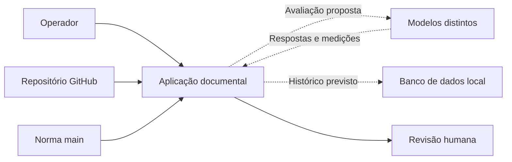
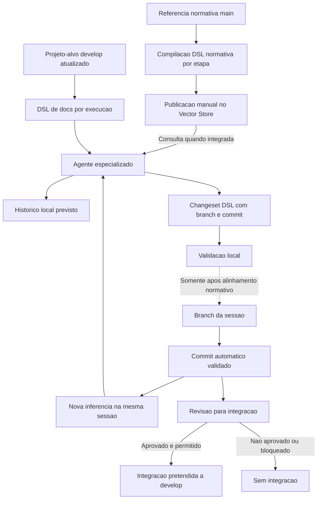

# Doc Arquitetura — Revisão documental e comparação de modelos

  

## Resumo executivo
A aplicação Doc Arquitetura permitirá organizar a revisão e o refinamento documental de projetos GitHub, utilizando diferentes provedores remotos de LLM, por quatro especializações: Charter, Scope, Implementation e Source. Compilará localmente a referência normativa externa `ahhvahh/doc-arquitetura/main/ProjectCharter/1.0`, manterá as configurações de cada agente reutilizável até uma atualização explícita, analisará o `/docs` atualizado do projeto-alvo e produzirá alterações rastreáveis para revisão antes da publicação em branch de tarefa, condicionada à autorização normativa.

## Propósito do projeto
| Campo | Definição |
|---|---|
| Problema | Analisar projetos extensos exige contexto elevado, gera custos diferentes por modelo e ainda não oferece histórico comparável de qualidade, tokens e despesas. |
| Propósito | Permitir refinamento documental por diferentes provedores remotos de LLM, com sessões contínuas de inferência, histórico local em métricas JSON recuperáveis, comparação de qualidade e custos e aprovação humana para integrar alterações à `develop`. |
| Beneficiários | Desenvolvedor responsável, revisor documental e operador da aplicação Debian. |
| Valor esperado | Menor trabalho manual de contexto, consistência normativa, alterações verificáveis e escolha de modelos apoiada por indicadores históricos de qualidade, consumo, tempo e custo. |

## Contexto e participantes
- [PCH-001 — Projeto e participantes](project-context/PCH-001-contexto-integracao-openai-dsl.md).

## Contexto multimodelo proposto
O diagrama representa as relações pretendidas, não funcionalidades já implementadas.

## Visão geral de alto nível

A DSL normativa é atualizada no Vector Store somente por comando explícito do operador, nunca por preparação de tarefa ou inferência. A cópia é derivada do SHA da main normativa e não substitui o Markdown original; consulta pelo agente depende de integração de pesquisa ainda pendente. Cada execução usa workspace isolado e projeto-alvo independente. O diagrama descreve intenção de produto, **não concede permissão** de escrever em branches de sessão nem de executar merge: a [OPEN-003](open-questions/OPEN-003-politica-de-branches.md) continua bloqueadora até a atualização autorizada da política normativa. A autorização de gastos de inferência é independente da revisão para integração Git.

## Objetivos e entregas esperadas
- [OBJ-001 — Quatro especializações](objectives/OBJ-001-agentes-documentais-especializados.md)
- [OBJ-002 — Contexto compacto e rastreável](objectives/OBJ-002-contexto-compacto-rastreavel.md)
- [OBJ-003 — Propostas verificáveis para revisão](objectives/OBJ-003-propostas-de-alteracoes-verificaveis.md)
- [OBJ-004 — Evidência de testes automatizados](objectives/OBJ-004-evidencias-de-testes-automatizados.md)
- [OBJ-005 — Inferência com orçamento controlado](objectives/OBJ-005-orcamento-previsivel-e-bloqueio.md)
- [OBJ-006 — Publicação manual da base normativa](objectives/OBJ-006-publicacao-manual-base-normativa.md)
- [OBJ-007 — Comparação entre modelos](objectives/OBJ-007-comparacao-controlada-de-modelos.md)
- [OBJ-008 — Histórico de inferências](objectives/OBJ-008-historico-local-de-inferencias.md)

## Fora do escopo
- [NOBJ-001 — Sem integração autônoma à develop](non-objectives/NOBJ-001-nao-publicar-sem-aprovacao.md)
- [NOBJ-002 — Sem inferência local na primeira entrega](non-objectives/NOBJ-002-sem-inferencia-local-na-primeira-entrega.md)

## Condições e premissas
- [CON-001 — Referência normativa versionada](conditions/CON-001-referencia-normativa-main.md)
- [CON-002 — Proteção de credenciais](conditions/CON-002-protecao-credenciais.md)
- [CON-003 — Separação entre norma externa e contratos do aplicativo](conditions/CON-003-contratos-do-aplicativo.md)
- [CON-004 — Orçamentos e aprovação prévia](conditions/CON-004-orcamento-obrigatorio.md)
- [CON-005 — Persistência local](conditions/CON-005-persistencia-local-de-inferencias.md)

## Questões abertas
- [OPEN-001 — Credenciais e armazenamento](open-questions/OPEN-001-politica-credenciais.md)
- [OPEN-002 — Fidelidade e orçamento de contexto](open-questions/OPEN-002-fidelidade-e-custo.md)
- [OPEN-003 — Política de branches](open-questions/OPEN-003-politica-de-branches.md)
- [OPEN-004 — Limites remotos por projeto OpenAI](open-questions/OPEN-004-projeto-openai-e-hard-limit.md)
- [OPEN-005 — Provedores e modelos](open-questions/OPEN-005-estrategia-de-provedores-e-modelos.md)
- [OPEN-006 — Retenção e sigilo do histórico (decisão C resolvida)](open-questions/OPEN-006-retencao-e-protecao-do-historico.md)

## Base normativa pesquisável — decisão de Charter

O operador poderá solicitar a compilação e sincronização manual da norma, separadamente para Charter, Scope, Implementation e Development (src). O comando apresenta prévia sem publicação por padrão; aplicação explícita habilita o envio em formato textual pesquisável. A aplicação compara hashes, registra versões e confirma indexação, evitando uploads redundantes. A publicação não executa agentes nem altera repositórios. Regras de consulta e contratos da CLI serão definidos em Scope e Implementation após os gates. Veja [OBJ-006](objectives/OBJ-006-publicacao-manual-base-normativa.md) e [OPEN-002](open-questions/OPEN-002-fidelidade-e-custo.md).

## Situação da baseline
**BLOCKED — Charter → Scope.** Esta é uma proposta inicial em `refinement`. A implementação não está autorizada por este rascunho. Requer revisão do responsável, validação das OPEN e auditoria completa dos critérios normativos.

## Histórico e referência
- [Referência normativa](https://github.com/ahhvahh/doc-arquitetura/tree/main/ProjectCharter/1.0) — somente leitura; `main`.
- [Projeto-alvo](https://github.com/ahhvahh/doc-arquitetura-app-debian/tree/develop) — branch de desenvolvimento.

## Registro da ampliação — 2026-10-21
A inclusão de comparação multimodelo e histórico local foi autorizada para refinamento documental; não equivale à conclusão de implementação ou do gate. As questões [OPEN-001](open-questions/OPEN-001-politica-credenciais.md), [OPEN-002](open-questions/OPEN-002-fidelidade-e-custo.md), [OPEN-003](open-questions/OPEN-003-politica-de-branches.md), [OPEN-004](open-questions/OPEN-004-projeto-openai-e-hard-limit.md), [OPEN-005](open-questions/OPEN-005-estrategia-de-provedores-e-modelos.md)  permanecem abertas para análise individual. A [OPEN-006](open-questions/OPEN-006-retencao-e-protecao-do-historico.md) teve sua decisão de retenção, acesso e descarte resolvida; controles técnicos exigem verificação posterior.

## Decisões funcionais de 2026-10-21 — provedores, sessões e métricas
- A [OPEN-005](open-questions/OPEN-005-estrategia-de-provedores-e-modelos.md) registra a opção B, múltiplos provedores remotos, mantendo a escolha inicial dos serviços pendente de viabilidade.
- A [OPEN-003](open-questions/OPEN-003-politica-de-branches.md) registra o fluxo desejado de **uma branch por sessão**, commits automáticos de resultados validados, novos prompts na sessão ativa e aprovação humana **somente da integração Git a `develop`**. A execução permanece bloqueada pela norma atual.
- O [OBJ-008](objectives/OBJ-008-historico-local-de-inferencias.md) exige métricas JSON recuperáveis para consulta e reconstrução de análises por aplicações autorizadas, sem impor formato interno do banco nesta etapa.

## Decisão sobre retenção do histórico — 2026-10-21
A opção C foi aprovada: **prompts, respostas e métricas JSON permanecem armazenados até exclusão manual**, sem expiração automática. Somente o operador e consumidores expressamente autorizados podem consultar os dados. Segredos devem ser protegidos e descartes devem ter evidência auditável sem exposição do conteúdo excluído.

A decisão está em [OPEN-006](open-questions/OPEN-006-retencao-e-protecao-do-historico.md), com requisitos em [OBJ-008](objectives/OBJ-008-historico-local-de-inferencias.md) e [CON-005](conditions/CON-005-persistencia-local-de-inferencias.md). O documento mantém badge `refinement` por indisponibilidade do badge `refined` em `docs/assets/`; este registro não autoriza alterar assets nem atesta controles implementados.

## Seleção de provedores da primeira entrega — 2026-10-21
O responsável escolheu explicitamente **OpenAI, Anthropic e Google Gemini** como provedores remotos **previstos**. A decisão nominal está em [OPEN-005](open-questions/OPEN-005-estrategia-de-provedores-e-modelos.md) e se reflete em [OBJ-001](objectives/OBJ-001-agentes-documentais-especializados.md), [OBJ-007](objectives/OBJ-007-comparacao-controlada-de-modelos.md) e [PCH-001](project-context/PCH-001-contexto-integracao-openai-dsl.md).

A escolha não significa implementação nem disponibilidade comprovada: cada serviço deve ser avaliado quanto a APIs, modelos/versões, custos, métricas, credenciais, tratamento de dados e limites financeiros. Sem evidências e controles suficientes, bloquear inferência paga e manter a pendência no Charter; nenhuma integração técnica ou código foi alterado nesta decisão.

## Política de autorização de inferências pagas — decisão de 2026-10-21
O responsável escolheu a opção A da [OPEN-004](open-questions/OPEN-004-projeto-openai-e-hard-limit.md): **bloquear qualquer chamada paga sem proteção remota suficiente, efetiva e comprovada**, além de limites locais e autorização financeira por inferência. Essa condição aplica-se aos três provedores previstos — **OpenAI, Anthropic e Google Gemini** — e não pode ser substituída por alertas, teto apenas local ou aceitação de risco.

Permanecem previstos **quatro projetos OpenAI independentes**, um por especialização, cuja proteção financeira precisa ser verificada individualmente antes de uso remunerado. A decisão não comprova disponibilidade de hard limits nem habilita modelos remotamente. Requisitos vinculados: [OBJ-005](objectives/OBJ-005-orcamento-previsivel-e-bloqueio.md), [CON-004](conditions/CON-004-orcamento-obrigatorio.md) e [OPEN-005](open-questions/OPEN-005-estrategia-de-provedores-e-modelos.md).

## Decisão de controle da qualidade documental — 2026-10-21
O responsável escolheu a **opção B** para a [OPEN-002](open-questions/OPEN-002-fidelidade-e-custo.md): cada resultado deverá passar por validação estrutural automatizada, **segunda análise por modelo de linguagem distinto** e **revisão humana final**. Um parecer favorável não dispensa testes nem comprova fidelidade semântica da DSL.

A segunda chamada é condicionada às restrições financeiras da [OPEN-004](open-questions/OPEN-004-projeto-openai-e-hard-limit.md), e o modelo revisor não possui autoridade de integração Git. A decisão está relacionada a [OBJ-003](objectives/OBJ-003-propostas-de-alteracoes-verificaveis.md), [OBJ-004](objectives/OBJ-004-evidencias-de-testes-automatizados.md), [OBJ-007](objectives/OBJ-007-comparacao-controlada-de-modelos.md) e [OBJ-005](objectives/OBJ-005-orcamento-previsivel-e-bloqueio.md).

A OPEN permanece em `refinement` até demonstrar a eficácia de validações, fidelidade da DSL, critérios de aceite e custos. Nenhuma integração, modelo secundário ou contrato técnico é declarado implementado.

## Política de execução segregada por usuário — decisão de 2026-10-21
O responsável escolheu a **opção C** na [OPEN-001](open-questions/OPEN-001-politica-credenciais.md): o serviço Linux poderá **organizar tarefas**, mas cada inferência será executada exclusivamente com a identidade e as credenciais do usuário autorizado correspondente, sem acesso cruzado aos cofres.

Persistem a segregação e a proteção de segredos em [CON-002](conditions/CON-002-protecao-credenciais.md), a autorização de gasto e a proteção remota de [OBJ-005](objectives/OBJ-005-orcamento-previsivel-e-bloqueio.md) e [CON-004](conditions/CON-004-orcamento-obrigatorio.md), bem como a divisão de participantes em [PCH-001](project-context/PCH-001-contexto-integracao-openai-dsl.md). A regra de quatro projetos OpenAI por especialização não foi substituída.

A decisão é uma orientação de produto, **não comprovação** de daemon, isolamento, cofre acessível em execução não interativa ou autorização efetiva. Tarefas sem identidade, cofre, isolamento ou proteção de gasto comprovados devem ser bloqueadas; os contratos técnicos ficam para Scope/Implementation.

## Resolução de divergências entre modelos — decisão de 2026-10-21
O responsável escolheu a **opção A** no refinamento da [OPEN-002](open-questions/OPEN-002-fidelidade-e-custo.md): divergências relevantes detectadas pelo segundo LLM devem ser **corrigidas e submetidas novamente a testes estruturais e análise crítica por outro modelo** antes da revisão humana final.

Falhas estruturais e normativas continuam bloqueadoras; sem reavaliação e resolução da discordância relevante, o conteúdo **não pode ser aceito nem registrado como resultado validado**. Repetições remuneradas exigem orçamento, autorização e proteção remota comprovada, segundo [OBJ-005](objectives/OBJ-005-orcamento-previsivel-e-bloqueio.md). Regras de aceite, testes e comparação estão relacionadas a [OBJ-003](objectives/OBJ-003-propostas-de-alteracoes-verificaveis.md), [OBJ-004](objectives/OBJ-004-evidencias-de-testes-automatizados.md) e [OBJ-007](objectives/OBJ-007-comparacao-controlada-de-modelos.md).

A autorização humana para integrar alterações à `develop` permanece separada, e a política de branches depende da [OPEN-003](open-questions/OPEN-003-politica-de-branches.md). A decisão é documental; **não demonstra implementação nem homologação da fidelidade semântica**.
