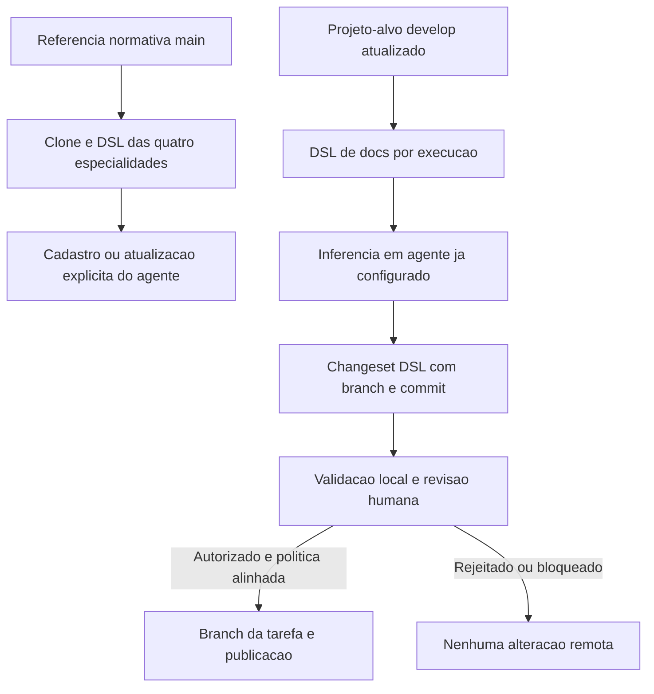

# Doc Arquitetura — Integração OpenAI e DSL

  

## Resumo executivo
A aplicação Doc Arquitetura permitirá organizar a revisão e o refinamento documental de projetos GitHub por quatro especializações: Charter, Scope, Implementation e Source. Compilará localmente a referência normativa externa `ahhvahh/doc-arquitetura/main/ProjectCharter/1.0`, manterá as configurações de cada agente reutilizável até uma atualização explícita, analisará o `/docs` atualizado do projeto-alvo e produzirá alterações rastreáveis para revisão antes da publicação em branch de tarefa, condicionada à autorização normativa.

## Propósito do projeto
| Campo | Definição |
|---|---|
| Problema | A revisão de um repositório documental extenso por modelos locais pode ser lenta; reenviar todo o Markdown eleva o custo e dificulta a rastreabilidade de alterações. |
| Propósito | Permitir análise documental assistida por IA com uso eficiente de contexto, resultados rastreáveis e revisão humana antes da publicação no GitHub. |
| Beneficiários | Desenvolvedor responsável, revisor documental e operador da aplicação Debian. |
| Valor esperado | Menos trabalho manual de preparação de contexto, atualizações consistentes com a norma e alterações verificáveis antes de commit. |

## Contexto e participantes
- [PCH-001 — Projeto e participantes](project-context/PCH-001-contexto-integracao-openai-dsl.md).

## Visão geral de alto nível

A DSL normativa não é reenviada em cada inferência; sua atualização remota tem comando próprio. Cada execução usa um workspace isolado, sem cache de contexto compartilhado entre inferências. Os agentes e suas versões normativas persistem no cadastro local e na conta OpenAI. O diagrama representa a intenção, não autoriza gravar fora de `develop` enquanto a norma vigente não for revista.

## Objetivos e entregas esperadas
- [OBJ-001 — Quatro especializações](objectives/OBJ-001-agentes-documentais-especializados.md)
- [OBJ-002 — Contexto compacto e rastreável](objectives/OBJ-002-contexto-compacto-rastreavel.md)
- [OBJ-003 — Propostas verificáveis para revisão](objectives/OBJ-003-propostas-de-alteracoes-verificaveis.md)
- [OBJ-004 — Evidência de testes automatizados](objectives/OBJ-004-evidencias-de-testes-automatizados.md)
- [OBJ-005 — Inferência com orçamento controlado](objectives/OBJ-005-orcamento-previsivel-e-bloqueio.md)

## Fora do escopo
- [NOBJ-001 — Sem publicação autônoma](non-objectives/NOBJ-001-nao-publicar-sem-aprovacao.md)

## Condições e premissas
- [CON-001 — Referência normativa versionada](conditions/CON-001-referencia-normativa-main.md)
- [CON-002 — Proteção de credenciais](conditions/CON-002-protecao-credenciais.md)
- [CON-003 — Separação entre norma externa e contratos do aplicativo](conditions/CON-003-contratos-do-aplicativo.md)
- [CON-004 — Orçamentos e aprovação prévia](conditions/CON-004-orcamento-obrigatorio.md)

## Questões abertas
- [OPEN-001 — Credenciais e armazenamento](open-questions/OPEN-001-politica-credenciais.md)
- [OPEN-002 — Fidelidade e orçamento de contexto](open-questions/OPEN-002-fidelidade-e-custo.md)
- [OPEN-003 — Política de branches](open-questions/OPEN-003-politica-de-branches.md)
- [OPEN-004 — Limites remotos por projeto OpenAI](open-questions/OPEN-004-projeto-openai-e-hard-limit.md)

## Situação da baseline
**BLOCKED — Charter → Scope.** Esta é uma proposta inicial em `refinement`. A implementação não está autorizada por este rascunho. Requer revisão do responsável, validação das OPEN e auditoria completa dos critérios normativos.

## Histórico e referência
- [Referência normativa](https://github.com/ahhvahh/doc-arquitetura/tree/main/ProjectCharter/1.0) — somente leitura; `main`.
- [Projeto-alvo](https://github.com/ahhvahh/doc-arquitetura-app-debian/tree/develop) — branch de desenvolvimento.
