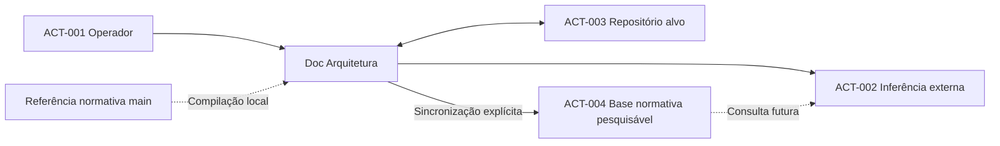

# PCH-001 — Contexto da integração OpenAI e DSL

  

## Contexto
O projeto existente dispõe de CLI Go, seleção de modelos locais, clonagem GitHub e conversão documental preliminar. A nova necessidade é viabilizar inferência externa por especialidade, com contexto compacto e alterações controladas. A existência de código anterior não comprova a conclusão dos gates documentais.

## ACT-001 — Operador e responsável pelo projeto
**Papel:** seleciona o projeto, define o objetivo de revisão e autoriza alterações.
**Interesse:** previsibilidade das modificações, rastreabilidade e custos compreensíveis.
**Interações:** escolhe projeto e etapa, solicita operações, pré-autoriza individualmente chamadas remuneradas, consulta informações permitidas e revisa diferenças propostas; o cadastro/revogação de segredos cabe exclusivamente ao administrador autorizado.
**Limites:** não delega autorização final de publicação ao modelo.

## ACT-002 — Serviço externo de inferência
**Papel:** produzir análises e propostas documentais conforme a etapa selecionada.
**Interesse:** receber contexto suficiente para realizar a tarefa solicitada.
**Interações:** recebe a tarefa do operador e, quando a consulta estiver integrada, poderá recuperar trechos da base normativa publicada explicitamente; recebe a DSL atual do projeto-alvo durante inferência com limite de gasto, e devolve proposta estruturada para revisão.
**Limites:** não possui autoridade para alterar o repositório sem as verificações e decisões da aplicação.

## ACT-003 — Repositório de documentação alvo
**Papel:** mantém os documentos e seu histórico de alterações.
**Interesse:** integridade da documentação, controle de versão e referências válidas.
**Interações:** fornece a baseline de `develop`, atualizada antes da inferência, e recebe alterações aprovadas em nova branch de tarefa quando a política normativa permitir.
**Limites:** o repositório normativo não é destino de gravação.

## ACT-004 — Armazenamento remoto da base normativa
**Papel:** disponibiliza cópia pesquisável da documentação normativa compilada por especialidade.
**Interesse:** consulta seletiva sem reenviar o acervo integral em cada inferência.
**Interações:** recebe atualização somente por solicitação do operador e registra IDs e indexação; pode ser consultado depois da integração com ferramenta de pesquisa.
**Limites:** não substitui a fonte GitHub, não armazena segredos, não modifica repositórios e não comprova fidelidade semântica.

## ACT-005 — Administrador Linux e gestor de credenciais

**Papel:** identidade administrativa autorizada que gerencia credenciais, associação ao grupo Linux habilitado e atividades administrativas do aplicativo.

**Interesse:** garantir segurança, segregação de funções, continuidade e revogação verificável sem expor segredos aos usuários comuns.

**Interações:** configura, substitui e revoga segredos em arquivos administrativos protegidos; controla os membros do grupo autorizado, instalação, atualizações manuais, backups e restaurações supervisionadas. A entrega de credenciais ao serviço utiliza mecanismo restrito do `systemd`, conforme as decisões vigentes.

**Limites:** não transfere os privilégios administrativos ao serviço ou ao grupo; pertencer ao grupo não habilita leitura direta de segredos/banco ou autorização de despesa. Menções históricas a cofre dedicado foram superadas pela política vigente de arquivos Linux protegidos.

## ACT-006 — Serviço executor local

**Papel:** processo autônomo sob identidade Linux técnica exclusiva, intermediário obrigatório entre clientes autorizados, histórico local e provedores de inferência.

**Interesse:** aplicar de forma rastreável autorização, isolamento, bloqueios financeiros e recuperação segura de tarefas.

**Interações:** recebe solicitações do grupo autorizado via aplicação, verifica identidade e permissão por operação, mantém registros no banco local privado e realiza chamadas externas somente depois de superar as verificações de credenciais, autorização individual e custo. Opera independentemente da sessão interativa do solicitante; preserva estados e evidencia falhas.

**Limites:** não concede privilégios administrativos, não aceita comandos arbitrários, não expõe banco/segredos diretamente aos clientes e não executa operações Git proibidas pela norma vigente. Os mecanismos técnicos concretos pertencem a Scope/Implementation.

## ACT-007 — Guardião opcional de acompanhamento

**Papel:** participante opcional que acompanha estados, pendências, falhas e resultados permitidos pela aplicação.

**Interesse:** receber visibilidade operacional sem assumir atribuições de administração ou autorização financeira.

**Interações:** consulta o acompanhamento por intermédio das interfaces autorizadas do serviço, mediante identidade/permissões aplicáveis ao grupo Linux.

**Limites:** não acessa diretamente o banco ou arquivos de segredos; não gerencia credenciais, não inicia despesas por conta própria, não altera permissões nem aprova operações Git ou integrações ao repositório. A existência deste papel não comprova implementação de um guardião.

## Relações
- [OBJ-001](../objectives/OBJ-001-agentes-documentais-especializados.md)
- [OBJ-002](../objectives/OBJ-002-contexto-compacto-rastreavel.md)
- [OBJ-003](../objectives/OBJ-003-propostas-de-alteracoes-verificaveis.md)
- [OBJ-005](../objectives/OBJ-005-orcamento-previsivel-e-bloqueio.md)
- [OBJ-006](../objectives/OBJ-006-publicacao-manual-base-normativa.md)

## Diagrama de contexto

O diagrama identifica participantes, não contratos de rede.

## Complemento de contexto — múltiplos modelos e histórico (2026-10-21)
O operador ACT-001 poderá solicitar análises comparativas entre modelos de custos e capacidades diferentes. ACT-002 representa serviços externos de inferência distintos, com **OpenAI e agentes Amazon Bedrock (AWS)** escolhidos para a primeira entrega pela decisão 22, condicionados à viabilidade em [OPEN-005](../open-questions/OPEN-005-estrategia-de-provedores-e-modelos.md). A primeira entrega exclui modelos locais conforme NOBJ-002. Não se alega que múltiplos provedores já estejam implementados.

A aplicação deverá conservar registros locais de solicitação, prompt, resultado, tokens e valores, associados ao repositório-alvo ACT-003, à norma versionada e à avaliação. A base normativa consultável ACT-004 não é o mesmo acervo de histórico de inferências e não deve misturar dados de projetos-alvo com a norma.

Relações: [OBJ-007](../objectives/OBJ-007-comparacao-controlada-de-modelos.md), [OBJ-008](../objectives/OBJ-008-historico-local-de-inferencias.md), [CON-005](../conditions/CON-005-persistencia-local-de-inferencias.md).

## Delimitação de atores — decisões 06 e 07
- **ACT-001 — Operador:** seleciona provedores remotos e prompts novos/existentes; acompanha o histórico de uma sessão e aprova somente a integração Git final à `develop`. Autorizações financeiras exigidas por inferência permanecem independentes.
- **ACT-002 — Serviço externo de inferência:** representa a integração direta OpenAI e a integração de agentes Amazon Bedrock (AWS), individualmente sujeitas a validação de viabilidade, incluindo modelos subjacentes e controle de custos, sem receber autoridade para criar commits ou aprovar integrações. A primeira entrega exclui modelos locais.
- **ACT-003 — Repositório-alvo:** a visão futura prevê uma branch por sessão, com commits produzidos pela aplicação após validação e integrados somente após aprovação humana; essa interação ainda depende da resolução normativa de [OPEN-003](../open-questions/OPEN-003-politica-de-branches.md).

As métricas de inferência permanecem sob controle local e devem ser recuperáveis em JSON por consumidores autorizados, conforme [OBJ-008](../objectives/OBJ-008-historico-local-de-inferencias.md). Não existe autorização atual para criar ou atualizar branches diferentes de `develop`.

## Contexto de serviço coordenador e isolamento de identidade — decisão 11 (2026-10-21)

**Registro histórico parcialmente superado (2026-10-22):** o serviço deixa de ser apenas coordenador sem capacidade executora; a inferência ocorre sob identidade exclusiva do serviço autorizado, e não sob credenciais pessoais do operador. Permanecem autoria, acesso restrito, auditoria e proibição de custos sem autorização.
Na evolução pretendida, o serviço Linux funciona como **organizador das solicitações dos operadores**, sem obter autoridade para consultar cofres pessoais, transferir segredos entre usuários ou realizar uma inferência em nome de outro usuário.

- **ACT-001 — Operador:** cada tarefa tem um usuário responsável identificado; somente seu contexto autorizado pode executar inferências, acessar suas próprias credenciais e consumir orçamento mediante a autorização financeira exigida.
- **ACT-002 — Serviço externo de inferência:** recebe exclusivamente a requisição autorizada a partir do contexto de execução do usuário responsável, não do cofre de outro operador.
- **Serviço coordenador previsto:** organiza a fila e o acompanhamento, não representa uma nova fonte autônoma de autorização de inferência ou de consumo pago.

A política aprovada não presume que o serviço ou o mecanismo de isolamento já existam. Devem ser verificados em etapas posteriores, conforme [OPEN-001](../open-questions/OPEN-001-politica-credenciais.md), [CON-002](../conditions/CON-002-protecao-credenciais.md) e [CON-004](../conditions/CON-004-orcamento-obrigatorio.md).

## Distinção dos repositórios e responsabilidades da sessão — decisão 15 (2026-10-21)
O projeto envolve **três papéis distintos de repositório**, que não podem ser confundidos:
- **Aplicação em desenvolvimento:** `ahhvahh/doc-arquitetura-app-debian`, onde ficam o programa e a documentação de seus objetivos; não constitui o repositório de trabalho implicitamente escolhido para sessões futuras.
- **Fonte normativa fixa:** `ahhvahh/doc-arquitetura`, `main/ProjectCharter/1.0`, somente leitura, que orienta os critérios documentais.
- **ACT-003 — Repositório-alvo da sessão:** GitHub informado pelo **ACT-001 — Operador** ao iniciar o trabalho, com `develop` como baseline e destino pretendido da PR; não é predefinido pela aplicação.

O ACT-001 seleciona o repositório e nível documental, acompanha uma sessão identificada, recebe o diff acumulado e **aprova o encerramento antes da criação da PR**. Posteriormente, examina também as validações da PR e autoriza **separadamente a integração Git**.

O contexto da sessão prevê uma única branch `feature/doc/{session-id}`, commits verificados durante as inferências e, ao final, uma PR para `develop` com GitHub Actions. A aplicação é responsável pela governança e os modelos de linguagem não possuem permissão Git autônoma. A operacionalização continua **bloqueada por [OPEN-003](../open-questions/OPEN-003-politica-de-branches.md)** até que a restrição normativa da escrita somente em `develop` seja formalmente revista em processo independente.

## Delimitação das duas integrações iniciais — decisão 22
O ator externo **ACT-002** passa a abranger exclusivamente as duas integrações planejadas para a primeira entrega: **OpenAI direta** e **agentes Amazon Bedrock (AWS)**. Anthropic e Gemini deixam de ser integrações diretas previstas para esta entrega, conforme [NOBJ-004](../non-objectives/NOBJ-004-nao-integrar-outros-provedores-na-primeira-entrega.md).

Não confundir o **agente AWS** com um **modelo de fundação específico**: identificação, disponibilidade do agente e modelo subjacente deverão ser verificadas na modalidade AWS agora selecionada, **Amazon Bedrock AgentCore**, ainda sem homologação. Nenhum ator externo recebe autorização para modificar Git, contornar a referência normativa ou gastar recursos de outro usuário. A oferta AWS escolhida é Amazon Bedrock AgentCore, conforme a decisão 23 de [OPEN-005](../open-questions/OPEN-005-estrategia-de-provedores-e-modelos.md); sua viabilidade e homologação permanecem pendentes.

## Delimitação de atores — cofre administrado e serviço autônomo (2026-10-22)

- **ACT-001 — Operador/solicitante:** é usuário Linux autenticado que integra o grupo autorizado para utilizar a aplicação, registra comandos, pré-autoriza despesas **individualmente** e consulta via aplicação tarefas/resultados compartilhados do grupo; não acessa diretamente o banco nem cadastra ou consulta segredos, salvo atribuição administrativa específica.
- **ACT-005 — Administrador de credenciais:** configura, substitui e revoga segredos após a instalação, por identidade administrativa autorizada, sem expor valores aos operadores.
- **ACT-006 — Serviço executor local:** com identidade exclusiva e acesso mínimo, consome tarefas autorizadas, utiliza os segredos estritamente necessários, executa sem depender da sessão interativa do solicitante e atualiza estados/resultados no banco local.
- **ACT-007 — Guardião opcional:** acompanha exclusivamente as pendências e resultados autorizados, sem ler o cofre, iniciar inferências por conta própria ou aprovar despesas.
- **ACT-002 — Serviço externo de inferência:** permanece distinto do executor local e somente recebe chamadas permitidas com orçamento e proteção remota aplicáveis; a escolha de provedores permanece sujeita à [OPEN-005](../open-questions/OPEN-005-estrategia-de-provedores-e-modelos.md).

**Limites de autoridade:** o cofre pertence à esfera de administração; o banco de tarefas mantém solicitações e auditoria, **não segredos**; permissão para acompanhar ou consultar não é permissão para executar, excluir, administrar credenciais ou aprovar gastos. Operações Git continuam sujeitas à [OPEN-003](../open-questions/OPEN-003-politica-de-branches.md) e à restrição normativa de escrita exclusiva em `develop`.

**Situação:** papéis e limites `DOCUMENTED`, não `IMPLEMENTED`. Contratos técnicos de processos, autorizações e persistência pertencem a Scope/Implementation. Relações: [OPEN-001](../open-questions/OPEN-001-politica-credenciais.md), [CON-002](../conditions/CON-002-protecao-credenciais.md), [CON-005](../conditions/CON-005-persistencia-local-de-inferencias.md), [OBJ-005](../objectives/OBJ-005-orcamento-previsivel-e-bloqueio.md) e [OBJ-008](../objectives/OBJ-008-historico-local-de-inferencias.md).

## Limite de confiança — autenticação Linux e mediação exclusiva da aplicação (2026-10-22)

- **Administração do servidor Linux:** gerencia usuários do sistema e associação ao grupo de acesso à aplicação. Autenticação Linux e participação no grupo bastam para utilização das funcionalidades comuns; **não haverá cadastro, senha ou concessões individuais de leitura paralelos na aplicação**.
- **ACT-001 — Usuário do grupo:** utiliza a aplicação instalada para submeter solicitações e consultar resultados compartilhados com os demais membros. A identidade Linux é registrada como autoria, sem confundi-la com a identidade executora.
- **ACT-006 — Serviço executor local:** é o intermediário obrigatório entre o cliente e o **banco de dados local canônico**, usando exclusivamente sua identidade técnica autorizada para leitura/escrita. Impede conexões diretas de usuários comuns e controla operações distintas de mera consulta.
- **ACT-007 — Guardião opcional:** acompanha dados somente pelas funções autorizadas da aplicação/serviço; não recebe acesso ao banco ou ao cofre.
- **ACT-005 — Administrador de credenciais:** permanece responsável pela gestão do cofre. Associação ao grupo de acesso **não** confere esses poderes.

**Separação preservada:** consulta compartilhada não autoriza exclusão de registros, pagamento, uso de credenciais, publicação de mudanças ou operações Git fora da norma. Localização concreta do banco, protocolo e mecanismos de permissão pertencem a Scope/Implementation.

**Superação documental:** a antiga limitação de leitura individual e concessões explícitas por tarefa/projeto foi superada **somente para consulta**; seguem válidas as responsabilidades dos atores e a auditoria. Relações: [OPEN-001](../open-questions/OPEN-001-politica-credenciais.md), [CON-005](../conditions/CON-005-persistencia-local-de-inferencias.md), [OBJ-008](../objectives/OBJ-008-historico-local-de-inferencias.md), [OPEN-006](../open-questions/OPEN-006-retencao-e-protecao-do-historico.md). `DOCUMENTED`, não `IMPLEMENTED`.

## Fronteiras e papéis aprovados para a primeira entrega (2026-10-22)

**Origem:** Segurança **1A/2A/3A**, Continuidade **1A/2A/3A/4A**, Backup/restauração **1A/2A/3A** e Instalação/manutenção **A/A/A**.

- **ACT-001 — Operador:** usuário Linux autenticado pertencente ao grupo autorizado; seu cliente faz consultas e solicitações exclusivamente por **um socket Unix local protegido**, sem acesso direto ao banco, aos segredos nem às APIs OpenAI/AWS da aplicação.
- **ACT-006 — Serviço autônomo:** sob identidade Linux técnica separada e privilégio mínimo, é o **único intermediário de operações** com banco local privado, credenciais fornecidas por `systemd` e provedores OpenAI/Amazon Bedrock AgentCore. Verifica identidade real e autorização por operação, registra evidência e disponibiliza diagnóstico essencial. Não aceita execução de comando arbitrário.
- **ACT-005 — Administrador:** controla grupo Linux, credenciais em arquivos protegidos, atualizações manuais, alteração de configuração confirmada em condição segura, backups manuais e restaurações supervisionadas. Privilégios administrativos não são transferidos ao serviço comum nem a integrantes do grupo.
- **ACT-007 — Guardião opcional:** acompanhamento somente pelo serviço, sem acesso ao banco ou segredos e sem poderes administrativos ou financeiros.
- **ACT-002 — Provedores externos:** chamadas da aplicação partem exclusivamente do serviço após verificação das proteções financeiras; grupo de acesso não é autorização de despesa.
- **Continuidade:** perda da conexão não prova que operação não ocorreu; serviço pode reiniciar automaticamente, mas sessões interrompidas exigem decisão humana de recuperação. Corrupção bloqueia operações dependentes. Status e falhas essenciais são consultáveis pelo usuário, sem expor informações administrativas.

**Limites:** a associação ao grupo habilita consulta compartilhada via serviço, não exclusão, despesa alheia ou operação Git fora da norma. Não definir aqui formato/protocolo interno, software de banco, arquivos físicos ou mecanismos de instalação; todos dependem das etapas técnicas. Não afirmar bloqueio geral de Internet a processos alheios. `DOCUMENTED`, não `IMPLEMENTED`; `refinement`. Relações: [OPEN-001](../open-questions/OPEN-001-politica-credenciais.md), [CON-002](../conditions/CON-002-protecao-credenciais.md), [CON-005](../conditions/CON-005-persistencia-local-de-inferencias.md), [OBJ-008](../objectives/OBJ-008-historico-local-de-inferencias.md), [OPEN-006](../open-questions/OPEN-006-retencao-e-protecao-do-historico.md).
