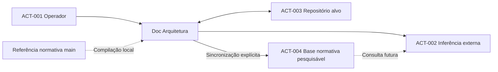

# PCH-001 — Contexto da integração OpenAI e DSL

  

## Contexto
O projeto existente dispõe de CLI Go, seleção de modelos locais, clonagem GitHub e conversão documental preliminar. A nova necessidade é viabilizar inferência externa por especialidade, com contexto compacto e alterações controladas. A existência de código anterior não comprova a conclusão dos gates documentais.

## ACT-001 — Operador e responsável pelo projeto
**Papel:** seleciona o projeto, define o objetivo de revisão e autoriza alterações.
**Interesse:** previsibilidade das modificações, rastreabilidade e custos compreensíveis.
**Interações:** fornece credenciais, configura orçamentos locais e remotos, escolhe etapa, aprova previsões de custos e revisa diferenças propostas.
**Limites:** não delega autorização final de publicação ao modelo.

## ACT-002 — Serviço externo de inferência
**Papel:** produzir análises e propostas documentais conforme a etapa selecionada.
**Interesse:** receber contexto suficiente para realizar a tarefa solicitada.
**Interações:** recebe a tarefa do operador e, quando a consulta estiver integrada, poderá recuperar trechos da base normativa publicada explicitamente; recebe a DSL atual do projeto-alvo durante inferência com limite de gasto, e devolve proposta estruturada para revisão.
**Limites:** não possui autoridade para alterar o repositório sem as verificações e decisões da aplicação.

## ACT-003 — Repositório de documentação alvo
**Papel:** mantém os documentos e seu histórico de alterações.
**Interesse:** integridade da documentação, controle de versão e referências válidas.
**Interações:** fornece a baseline de `develop`, atualizada antes da inferência, e recebe alterações aprovadas em nova branch de tarefa quando a política normativa permitir.
**Limites:** o repositório normativo não é destino de gravação.

## ACT-004 — Armazenamento remoto da base normativa
**Papel:** disponibiliza cópia pesquisável da documentação normativa compilada por especialidade.
**Interesse:** consulta seletiva sem reenviar o acervo integral em cada inferência.
**Interações:** recebe atualização somente por solicitação do operador e registra IDs e indexação; pode ser consultado depois da integração com ferramenta de pesquisa.
**Limites:** não substitui a fonte GitHub, não armazena segredos, não modifica repositórios e não comprova fidelidade semântica.

## Relações
- [OBJ-001](../objectives/OBJ-001-agentes-documentais-especializados.md)
- [OBJ-002](../objectives/OBJ-002-contexto-compacto-rastreavel.md)
- [OBJ-003](../objectives/OBJ-003-propostas-de-alteracoes-verificaveis.md)
- [OBJ-005](../objectives/OBJ-005-orcamento-previsivel-e-bloqueio.md)
- [OBJ-006](../objectives/OBJ-006-publicacao-manual-base-normativa.md)

## Diagrama de contexto

O diagrama identifica participantes, não contratos de rede.

## Complemento de contexto — múltiplos modelos e histórico (2026-10-21)
O operador ACT-001 poderá solicitar análises comparativas entre modelos de custos e capacidades diferentes. ACT-002 representa serviços externos de inferência potencialmente distintos; a inclusão de modelos locais permanece em análise na [OPEN-005](../open-questions/OPEN-005-estrategia-de-provedores-e-modelos.md). Não se alega que múltiplos provedores já estejam implementados.

A aplicação deverá conservar registros locais de solicitação, prompt, resultado, tokens e valores, associados ao repositório-alvo ACT-003, à norma versionada e à avaliação. A base normativa consultável ACT-004 não é o mesmo acervo de histórico de inferências e não deve misturar dados de projetos-alvo com a norma.

Relações: [OBJ-007](../objectives/OBJ-007-comparacao-controlada-de-modelos.md), [OBJ-008](../objectives/OBJ-008-historico-local-de-inferencias.md), [CON-005](../conditions/CON-005-persistencia-local-de-inferencias.md).

## Delimitação de atores — decisões 06 e 07
- **ACT-001 — Operador:** seleciona provedores remotos e prompts novos/existentes; acompanha o histórico de uma sessão e aprova somente a integração Git final à `develop`. Autorizações financeiras exigidas por inferência permanecem independentes.
- **ACT-002 — Serviço externo de inferência:** pode corresponder a provedores remotos distintos, sem receber autoridade para criar commits ou aprovar integrações. A primeira entrega exclui modelos locais.
- **ACT-003 — Repositório-alvo:** a visão futura prevê uma branch por sessão, com commits produzidos pela aplicação após validação e integrados somente após aprovação humana; essa interação ainda depende da resolução normativa de [OPEN-003](../open-questions/OPEN-003-politica-de-branches.md).

As métricas de inferência permanecem sob controle local e devem ser recuperáveis em JSON por consumidores autorizados, conforme [OBJ-008](../objectives/OBJ-008-historico-local-de-inferencias.md). Não existe autorização atual para criar ou atualizar branches diferentes de `develop`.
