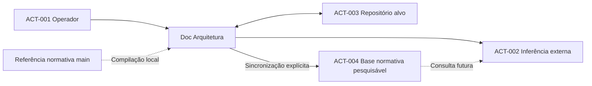

# PCH-001 — Contexto da integração OpenAI e DSL

  

## Contexto
O projeto existente dispõe de CLI Go, seleção de modelos locais, clonagem GitHub e conversão documental preliminar. A nova necessidade é viabilizar inferência externa por especialidade, com contexto compacto e alterações controladas. A existência de código anterior não comprova a conclusão dos gates documentais.

## ACT-001 — Operador e responsável pelo projeto
**Papel:** seleciona o projeto, define o objetivo de revisão e autoriza alterações.
**Interesse:** previsibilidade das modificações, rastreabilidade e custos compreensíveis.
**Interações:** fornece credenciais, configura orçamentos locais e remotos, escolhe etapa, aprova previsões de custos e revisa diferenças propostas.
**Limites:** não delega autorização final de publicação ao modelo.

## ACT-002 — Serviço externo de inferência
**Papel:** produzir análises e propostas documentais conforme a etapa selecionada.
**Interesse:** receber contexto suficiente para realizar a tarefa solicitada.
**Interações:** recebe a tarefa do operador e, quando a consulta estiver integrada, poderá recuperar trechos da base normativa publicada explicitamente; recebe a DSL atual do projeto-alvo durante inferência com limite de gasto, e devolve proposta estruturada para revisão.
**Limites:** não possui autoridade para alterar o repositório sem as verificações e decisões da aplicação.

## ACT-003 — Repositório de documentação alvo
**Papel:** mantém os documentos e seu histórico de alterações.
**Interesse:** integridade da documentação, controle de versão e referências válidas.
**Interações:** fornece a baseline de `develop`, atualizada antes da inferência, e recebe alterações aprovadas em nova branch de tarefa quando a política normativa permitir.
**Limites:** o repositório normativo não é destino de gravação.

## ACT-004 — Armazenamento remoto da base normativa
**Papel:** disponibiliza cópia pesquisável da documentação normativa compilada por especialidade.
**Interesse:** consulta seletiva sem reenviar o acervo integral em cada inferência.
**Interações:** recebe atualização somente por solicitação do operador e registra IDs e indexação; pode ser consultado depois da integração com ferramenta de pesquisa.
**Limites:** não substitui a fonte GitHub, não armazena segredos, não modifica repositórios e não comprova fidelidade semântica.

## Relações
- [OBJ-001](../objectives/OBJ-001-agentes-documentais-especializados.md)
- [OBJ-002](../objectives/OBJ-002-contexto-compacto-rastreavel.md)
- [OBJ-003](../objectives/OBJ-003-propostas-de-alteracoes-verificaveis.md)
- [OBJ-005](../objectives/OBJ-005-orcamento-previsivel-e-bloqueio.md)
- [OBJ-006](../objectives/OBJ-006-publicacao-manual-base-normativa.md)

## Diagrama de contexto

O diagrama identifica participantes, não contratos de rede.

## Complemento de contexto — múltiplos modelos e histórico (2026-10-21)
O operador ACT-001 poderá solicitar análises comparativas entre modelos de custos e capacidades diferentes. ACT-002 representa serviços externos de inferência distintos, com **OpenAI e agentes Amazon Bedrock (AWS)** escolhidos para a primeira entrega pela decisão 22, condicionados à viabilidade em [OPEN-005](../open-questions/OPEN-005-estrategia-de-provedores-e-modelos.md). A primeira entrega exclui modelos locais conforme NOBJ-002. Não se alega que múltiplos provedores já estejam implementados.

A aplicação deverá conservar registros locais de solicitação, prompt, resultado, tokens e valores, associados ao repositório-alvo ACT-003, à norma versionada e à avaliação. A base normativa consultável ACT-004 não é o mesmo acervo de histórico de inferências e não deve misturar dados de projetos-alvo com a norma.

Relações: [OBJ-007](../objectives/OBJ-007-comparacao-controlada-de-modelos.md), [OBJ-008](../objectives/OBJ-008-historico-local-de-inferencias.md), [CON-005](../conditions/CON-005-persistencia-local-de-inferencias.md).

## Delimitação de atores — decisões 06 e 07
- **ACT-001 — Operador:** seleciona provedores remotos e prompts novos/existentes; acompanha o histórico de uma sessão e aprova somente a integração Git final à `develop`. Autorizações financeiras exigidas por inferência permanecem independentes.
- **ACT-002 — Serviço externo de inferência:** representa a integração direta OpenAI e a integração de agentes Amazon Bedrock (AWS), individualmente sujeitas a validação de viabilidade, incluindo modelos subjacentes e controle de custos, sem receber autoridade para criar commits ou aprovar integrações. A primeira entrega exclui modelos locais.
- **ACT-003 — Repositório-alvo:** a visão futura prevê uma branch por sessão, com commits produzidos pela aplicação após validação e integrados somente após aprovação humana; essa interação ainda depende da resolução normativa de [OPEN-003](../open-questions/OPEN-003-politica-de-branches.md).

As métricas de inferência permanecem sob controle local e devem ser recuperáveis em JSON por consumidores autorizados, conforme [OBJ-008](../objectives/OBJ-008-historico-local-de-inferencias.md). Não existe autorização atual para criar ou atualizar branches diferentes de `develop`.

## Contexto de serviço coordenador e isolamento de identidade — decisão 11 (2026-10-21)
Na evolução pretendida, o serviço Linux funciona como **organizador das solicitações dos operadores**, sem obter autoridade para consultar cofres pessoais, transferir segredos entre usuários ou realizar uma inferência em nome de outro usuário.

- **ACT-001 — Operador:** cada tarefa tem um usuário responsável identificado; somente seu contexto autorizado pode executar inferências, acessar suas próprias credenciais e consumir orçamento mediante a autorização financeira exigida.
- **ACT-002 — Serviço externo de inferência:** recebe exclusivamente a requisição autorizada a partir do contexto de execução do usuário responsável, não do cofre de outro operador.
- **Serviço coordenador previsto:** organiza a fila e o acompanhamento, não representa uma nova fonte autônoma de autorização de inferência ou de consumo pago.

A política aprovada não presume que o serviço ou o mecanismo de isolamento já existam. Devem ser verificados em etapas posteriores, conforme [OPEN-001](../open-questions/OPEN-001-politica-credenciais.md), [CON-002](../conditions/CON-002-protecao-credenciais.md) e [CON-004](../conditions/CON-004-orcamento-obrigatorio.md).

## Distinção dos repositórios e responsabilidades da sessão — decisão 15 (2026-10-21)
O projeto envolve **três papéis distintos de repositório**, que não podem ser confundidos:
- **Aplicação em desenvolvimento:** `ahhvahh/doc-arquitetura-app-debian`, onde ficam o programa e a documentação de seus objetivos; não constitui o repositório de trabalho implicitamente escolhido para sessões futuras.
- **Fonte normativa fixa:** `ahhvahh/doc-arquitetura`, `main/ProjectCharter/1.0`, somente leitura, que orienta os critérios documentais.
- **ACT-003 — Repositório-alvo da sessão:** GitHub informado pelo **ACT-001 — Operador** ao iniciar o trabalho, com `develop` como baseline e destino pretendido da PR; não é predefinido pela aplicação.

O ACT-001 seleciona o repositório e nível documental, acompanha uma sessão identificada, recebe o diff acumulado e **aprova o encerramento antes da criação da PR**. Posteriormente, examina também as validações da PR e autoriza **separadamente a integração Git**.

O contexto da sessão prevê uma única branch `feature/doc/{session-id}`, commits verificados durante as inferências e, ao final, uma PR para `develop` com GitHub Actions. A aplicação é responsável pela governança e os modelos de linguagem não possuem permissão Git autônoma. A operacionalização continua **bloqueada por [OPEN-003](../open-questions/OPEN-003-politica-de-branches.md)** até que a restrição normativa da escrita somente em `develop` seja formalmente revista em processo independente.

## Delimitação das duas integrações iniciais — decisão 22
O ator externo **ACT-002** passa a abranger exclusivamente as duas integrações planejadas para a primeira entrega: **OpenAI direta** e **agentes Amazon Bedrock (AWS)**. Anthropic e Gemini deixam de ser integrações diretas previstas para esta entrega, conforme [NOBJ-004](../non-objectives/NOBJ-004-nao-integrar-outros-provedores-na-primeira-entrega.md).

Não confundir o **agente AWS** com um **modelo de fundação específico**: identificação, disponibilidade do agente e modelo subjacente dependem da modalidade AWS escolhida e de homologação. Nenhum ator externo recebe autorização para modificar Git, contornar a referência normativa ou gastar recursos de outro usuário. A escolha da oferta concreta AWS está pendente em [OPEN-005](../open-questions/OPEN-005-estrategia-de-provedores-e-modelos.md).
